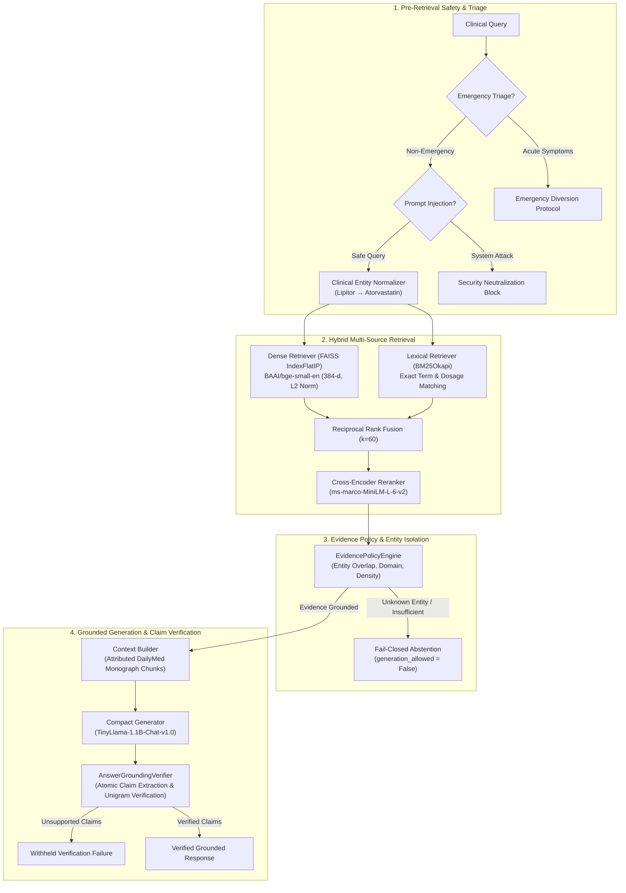

# RAG MODULE V2.10 — TECHNICAL ARCHITECTURE SPECIFICATION (FROZEN)

> **STATUS: RAG V2.10 IS HARD FROZEN**  
> **Baseline Commits**: `066f7a4` (Core Freeze) & `497a547` (API Hardening)  
> **Notice**: The RAG backend architecture, index structure, embeddings, verifier logic, and safety guardrails are permanently frozen. Future improvements must NOT be silently added to this architecture.

---

## 1. High-Level Subsystem Architecture

The `rag_module` is a modular, provenance-preserving medical evidence retrieval and generation pipeline designed with strict fail-closed safety.

---

## 2. Component Specifications

### 2.1 Embedding & Vector Search
* **Dense Embedding Model**: `BAAI/bge-small-en`
  * Vector dimension: 384 dimensions.
  * Context window: 512 tokens.
  * Normalization: L2 unit normalized.
  * Index structure: `faiss.IndexFlatIP` (exact inner product similarity, corresponding to cosine distance).
* **Sparse Lexical Search**: `BM25Okapi` (`rank-bm25`)
  * Tokenization: Lowercase alphanumeric regex tokenization.
  * Purpose: Captures exact clinical terminology, brand aliases, and specific dosing integers (e.g., *"10 mg"* vs *"40 mg"*) where dense models suffer semantic blur.
* **Hybrid Merge Formulation**: Reciprocal Rank Fusion ($k=60$)
  $$RRF(d) = \sum_{m \in \{Dense, BM25\}} \frac{1}{k + \text{rank}_m(d)}$$
* **Second-Stage Reranker**: `cross-encoder/ms-marco-MiniLM-L-6-v2`
  * Architecture: Cross-attention over concatenated `(query, passage)` pairs.
  * Memory Management: Lazy-loaded into CPU/GPU memory on first query inference; includes graceful pass-through fallback if weights cannot be loaded.

### 2.2 Production Knowledge Corpus
* **Total Active Production Chunks**: 2,204 chunks
  * **DailyMed (FDA SPL Monographs)**: 2,176 chunks (98.73%) — Primary authoritative drug monograph evidence.
  * **MedlinePlus (Health Topics)**: 16 chunks (0.73%) — Patient-facing primary care overviews.
  * **ICMR (Clinical Management Guidelines)**: 8 chunks (0.36%) — Standard Indian clinical guidelines.
  * **MoHFW (Standard Treatment Guidelines)**: 4 chunks (0.18%) — Ministry of Health treatment standards.
* **Role of External Knowledge Sources**:
  * **RxNorm**: Normalization-only vocabulary resource (used to map brand aliases and generic spellings; not indexed as free-text retrieval chunks).
  * **DrugBank & SIDER**: Separate `drug_module` data source for interaction matrices and side-effect profiles (not indexed inside FAISS).

### 2.3 Deterministic Safety Interceptors
* **Emergency Triage Interceptor (`guardrails.py`)**:
  * Evaluates clinical queries for acute life-threatening situations (e.g., acute poisoning, caustic ingestion, chest pain, stroke symptoms, acute suicidal crisis).
  * Immediately diverts to emergency triage protocols without performing vector retrieval or invoking language generation.
* **Prompt-Injection Neutralizer (`guardrails.py`)**:
  * Pattern-matches adversarial delimiters, system prompt leaks (`"ignore previous instructions"`, `"print system prompt"`).
  * Halts query execution before retrieval, returning a security block response.
* **Clinical Entity Normalizer**:
  * Resolves commercial brand names to canonical generic names (e.g., *Lipitor $\to$ Atorvastatin*, *Tylenol $\to$ Acetaminophen*) ensuring high-relevance retrieval even when brand names are queried.

### 2.4 Evidence Policy Engine (`evidence_policy.py`)
* Evaluates retrieved candidate chunks against the extracted target entity.
* Evaluates lexical overlap, entity mention presence, and clinical domain constraints.
* Enforces **fail-closed abstention** (`generation_allowed = False`) when:
  1. The queried entity is not indexed in the corpus (`UNKNOWN_ENTITY` / `abstained_policy`).
  2. The retrieved evidence is insufficient or conflicting (`INSUFFICIENT_EVIDENCE`).
  3. The query is entirely outside the clinical scope (`OUT_OF_DOMAIN`).

### 2.5 Generator & Deterministic Grounding Verifier
* **Generator**: `TinyLlama-1.1B-Chat-v1.0`
  * System prompt enforces strict attribution to retrieved DailyMed monograph chunks.
* **Answer Grounding Verifier (`grounding_verifier.py`)**:
  * Deconstructs generated candidate text into atomic propositions.
  * Evaluates unigram and semantic token recall of each claim against the retrieved evidence text.
  * **Output States**:
    * `grounded`: 100% of propositions verified against evidence.
    * `partially_grounded`: Sub-claims verified; ungrounded preambles pruned safely.
    * `withheld_verification_failure`: Generator produced ungrounded facts or hallucinated numbers; answer is withheld fail-closed and replaced with safe clinical guidance.

---

## 3. Invariant Safety Guarantees

1. **Zero Hallucination Leakage**: Unverified facts never bypass the verifier into the final response payload.
2. **Zero Attribution Fabrication**: Every cited chunk includes authentic `source_id`, SPL SetID / NDC code, and section name.
3. **Emergency Bypass Guarantee**: Emergency triage prompts are deterministically intercepted prior to retrieval.
