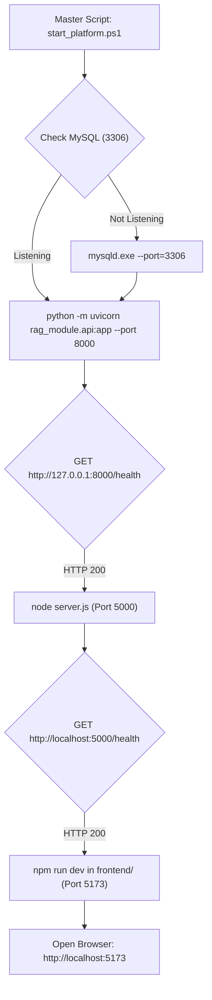
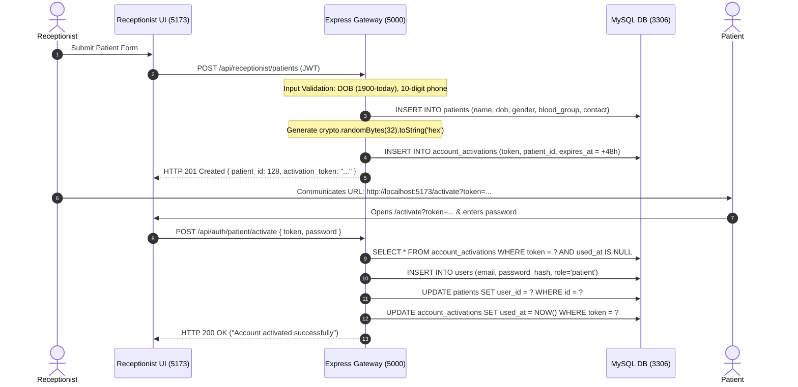
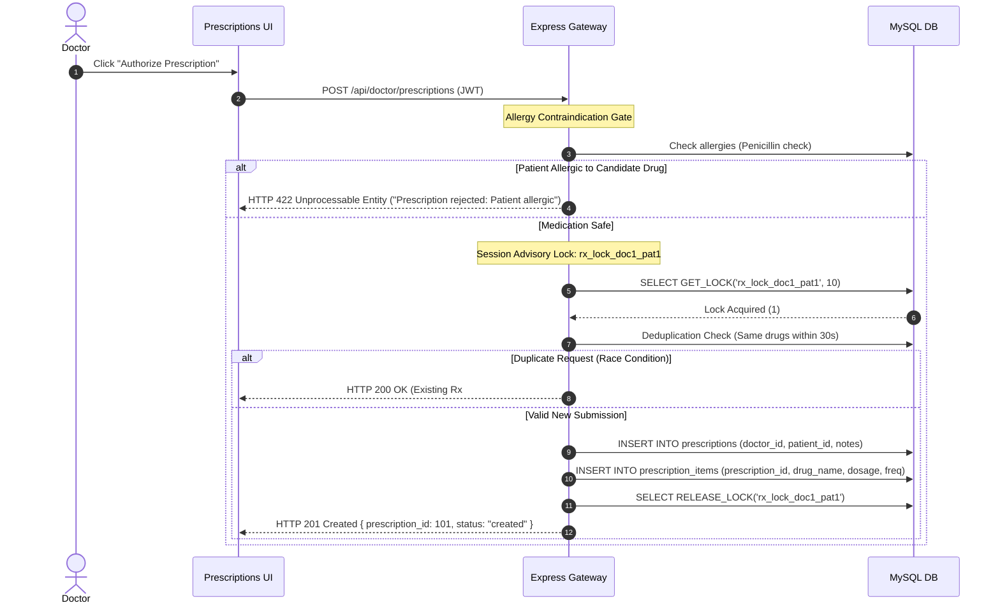
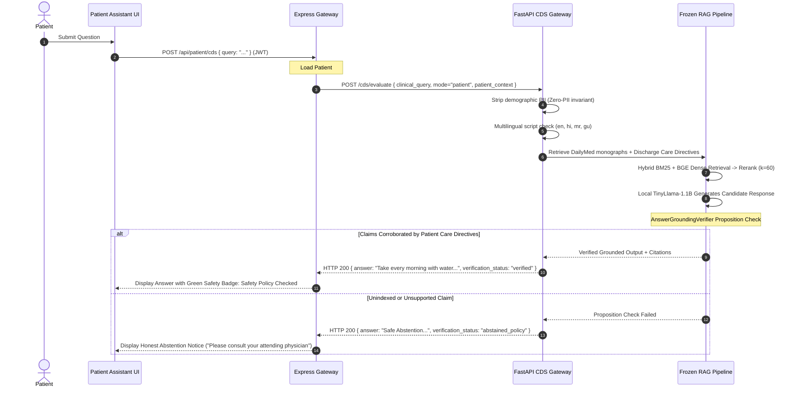

# FLOW.md — Execution & Data-Flow Map

> **Document Purpose**: Exact, function-by-function execution and data-flow map across all subsystems.  
> **Repository**: `dragyo7/healthcare-System-major-project-`  
> **Primary Branch**: `main` 
> **Audited Documentation Baseline**: `ac26bb7` 
> **Frozen RAG Implementation Baseline**: Commit `497a547` (V2.10 Hard-Frozen) 
> **Rule**: Every step reflects real, verified source code, exact file paths, and exact symbols.

---

## Table of Workflows

1. [Application Startup & Service Dependencies](#1-application-startup--service-dependencies)
2. [Login, JWT Issuance & Role-Based Access Control](#2-login-jwt-issuance--role-based-access-control)
3. [Receptionist Patient Intake & Cryptographic Account Activation](#3-receptionist-patient-intake--cryptographic-account-activation)
4. [Doctor Patient Dossier & Documented Allergy Retrieval](#4-doctor-patient-dossier--documented-allergy-retrieval)
5. [Deterministic Drug Interaction & Allergy Screening (<15ms)](#5-deterministic-drug-interaction--allergy-screening-15ms)
6. [Doctor Prescription Authoring, Advisory Locking & Deduplication](#6-doctor-prescription-authoring-advisory-locking--deduplication)
7. [Prescription PDF Ownership Verification & Binary Streaming](#7-prescription-pdf-ownership-verification--binary-streaming)
8. [Prescription Image OCR Upload & Mandatory Clinician Confirmation](#8-prescription-image-ocr-upload--mandatory-clinician-confirmation)
9. [Post-Discharge Directive Authoring & Retrieval](#9-post-discharge-directive-authoring--retrieval)
10. [Patient Post-Discharge Assistant & Fail-Closed Grounding](#10-patient-post-discharge-assistant--fail-closed-grounding)
11. [Clinical RAG Query (Retrieval, Rerank, Generate, Verify)](#11-clinical-rag-query-retrieval-rerank-generate-verify)
12. [Indic Multilingual Canonicalization & Localized Output](#12-indic-multilingual-canonicalization--localized-output)
13. [Negative & Security Defense Paths](#13-negative--security-defense-paths)
14. [Current Change Section](#14-current-change-section)

---

## 1. Application Startup & Service Dependencies

**Trigger**: Running `powershell -ExecutionPolicy Bypass -File ./scripts/start_platform.ps1` or `npm start`.

### Exact Call Path:
1. `scripts/start_platform.ps1` validates port availability using `Get-NetTCPConnection`.
2. Starts MySQL daemon on port 3306 pointing to `scratch/mysql_data/`.
3. Launches FastAPI gateway: `rag_module/api.py` loads `cds_module/router.py`, initializes `RAGService` (`rag_module/service.py`), and pre-warms FAISS index vectors (`index_v2.bin`).
4. Launches Express gateway: `Portal Major P/Bhumi/Doctor portal/backend/server.js` imports `src/app.js`, initializes MySQL connection pool (`src/config/db.js`), and registers CORS, rate limiters, and routes.
5. Launches Frontend: `frontend/vite.config.js` boots Vite development server on port 5173.

---

## 2. Login, JWT Issuance & Role-Based Access Control

**Entry Point**: `frontend/src/pages/Auth/Login.jsx` (`handleSubmit`)  
**Trigger**: User enters email, password, and selects role (`doctor`, `patient`, `receptionist`).

### Execution Path:
1. `Login.jsx` calls `api.post('/api/auth/<role>/login', { email, password })` defined in `frontend/src/api/authApi.js`.
2. Request hits Express router: `src/routes/authRoutes.js` $\to$ `authRateLimiter` (`src/middleware/rateLimiter.js`).
3. Express controller executes `doctorLogin`, `patientLogin`, or `receptionistLogin` in `src/controllers/authController.js`:
   - Queries `users` table: `SELECT * FROM users WHERE email = ? AND role = ?`.
   - Compares password with `bcrypt.compare(password, user.password_hash)`.
   - If valid, signs JWT: `jwt.sign({ id: user.id, role: user.role, email: user.email }, process.env.JWT_SECRET, { expiresIn: '24h' })`.
   - Returns `{ token, user: { id, email, role, name } }`.
4. Frontend `AuthContext.jsx` stores token in `localStorage.getItem('token')` and updates React state.
5. `AppRoutes.jsx` `RootRedirect` reads `user.role` and navigates to role workspace:
   - `doctor` $\to$ `/doctor` (guarded by `RoleGuard allowedRoles={['doctor']}`)
   - `patient` $\to$ `/patient` (guarded by `RoleGuard allowedRoles={['patient']}`)
   - `receptionist` $\to$ `/receptionist` (guarded by `RoleGuard allowedRoles={['receptionist']}`)

---

## 3. Receptionist Patient Intake & Cryptographic Account Activation

**Entry Point**: `frontend/src/pages/Receptionist/Patients.jsx` (`handleRegisterPatient`)  
**Trigger**: Receptionist fills demographic form (Name, DOB, Gender, Blood Group, Phone) and clicks "Register Patient".

### Exact Symbols & Files:
- Controller: `src/controllers/receptionistController.js:registerPatient`
- Date Validation: Lines 71–85 (`dobDate < minDate || dobDate > today`)
- Phone Sanitization: Line 88 (`emergency_contact.replace(/\D/g, '').slice(-10)`)
- Token Generation: `crypto.randomBytes(32).toString('hex')`
- Activation Controller: `src/controllers/authController.js:patientActivate`

---

## 4. Doctor Patient Dossier & Documented Allergy Retrieval

**Entry Point**: `frontend/src/pages/Doctor/Patients.jsx`  
**Trigger**: Doctor selects patient from roster.

### Execution Path:
1. Calls `GET /api/doctor/patients/:patientId` with JWT Bearer header.
2. Route guarded by `authenticateDoctor` (`src/middleware/authMiddleware.js`).
3. Express controller `getPatientDetails` (`src/controllers/doctorController.js:77`):
   - Executes SQL: `SELECT p.*, mh.condition_name, mh.allergies, mh.notes FROM patients p LEFT JOIN medical_histories mh ON p.id = mh.patient_id WHERE p.id = ?`.
4. Formats patient dossier object including allergy string (e.g. `Penicillin`).
5. Returns HTTP 200 with JSON dossier payload.
6. Frontend renders red alert badge in patient header: `Allergy: Penicillin`.

---

## 5. Deterministic Drug Interaction & Allergy Screening (<15ms)

**Entry Point**: `frontend/src/pages/Doctor/Prescriptions.jsx` (`handleScreenMedications`)  
**Trigger**: Doctor adds candidate drugs (`Atorvastatin` + `Clarithromycin`) in prescription form.

### Execution Path:
1. Frontend dispatches `POST /api/doctor/prescriptions/screen` with body `{ patient_id: 1, medications: ["Atorvastatin", "Clarithromycin"] }`.
2. Guarded by `authenticateDoctor`.
3. Express controller `screenPrescriptionSafety` (`src/controllers/doctorController.js:462`):
   - Fetches patient's documented allergies: `SELECT allergies FROM medical_histories WHERE patient_id = ?`.
   - Checks candidate medications against allergy list via string matching.
   - Forwards medications to FastAPI: `POST http://127.0.0.1:8000/cds/screen-prescription`.
4. FastAPI route `screen_prescription_endpoint` (`cds_module/router.py:44`) calls `CDSOrchestrator.screen_prescriptions` (`cds_module/orchestrator.py:270`):
   - Invokes `drug_module.interaction_engine.InteractionEngine.check_interactions(medications)`.
   - Checks pairwise drug combinations against `data/rules/medication_interactions/rules.json`.
   - Evaluates Rule `RUL-INT-007`: Severity `major`, mechanism `CYP3A4 inhibition increases statin toxicity`.
   - Returns in **< 15ms** without invoking any LLM inference.
5. Express combines DDI alerts with allergy warnings and returns HTTP 200.
6. Frontend displays interactive red alert box with severity badge and clinical guidance.

---

## 6. Doctor Prescription Authoring, Advisory Locking & Deduplication

**Entry Point**: `frontend/src/pages/Doctor/Prescriptions.jsx` (`handleSavePrescription`)  
**Trigger**: Doctor clicks "Authorize & Persist Prescription".

### Exact Symbols & Files:
- Controller: `src/controllers/doctorController.js:createPrescription` (Lines 185–310)
- Lock Function: `connection.query("SELECT GET_LOCK(?, 10) AS lock_acquired", [lockKey])`
- Deduplication: `SELECT id FROM prescriptions WHERE doctor_id = ? AND patient_id = ? AND created_at >= NOW() - INTERVAL 30 SECOND`
- Lock Timeout Failure: If `lock_acquired !== 1`, returns HTTP 503 (`"Unable to obtain prescription lock within timeout. Please retry."`).

---

## 7. Prescription PDF Ownership Verification & Binary Streaming

**Entry Point**: `frontend/src/pages/Doctor/Prescriptions.jsx` or `frontend/src/pages/Patient/Prescriptions.jsx`  
**Trigger**: User clicks "Download PDF".

### Execution Path:
1. Calls `GET /api/doctor/prescriptions/:prescriptionId/pdf` or `GET /api/patient/prescriptions/:prescriptionId/pdf`.
2. Guarded by `authenticateDoctor` or `authenticatePatient`.
3. Express controller `generatePrescriptionPDF` (`doctorController.js:335`) or `generatePatientPrescriptionPDF` (`patientController.js:80`):
   - Queries prescription record: `SELECT * FROM prescriptions WHERE id = ?`.
   - **Ownership Guard**:
     - For Doctor: `prescription.doctor_id === req.user.doctorId`.
     - For Patient: `prescription.patient_id === req.user.patientId`.
     - If mismatch: **Immediately returns HTTP 403 Forbidden with zero PDF bytes streamed**.
   - If authorized: Instantiates `PDFDocument` (`pdfkit`), writes hospital header, patient demographics, medications table, and doctor signature.
   - Pipes directly to `res`: `res.setHeader('Content-Type', 'application/pdf')`.
4. Browser downloads binary stream starting with magic bytes `%PDF-1.3`.

---

## 8. Prescription Image OCR Upload & Mandatory Clinician Confirmation

**Entry Point**: `frontend/src/pages/Doctor/Prescriptions.jsx` (`handleOcrUpload`)  
**Trigger**: Doctor uploads a scanned prescription image file.

### Execution Path:
1. Dispatches `POST /api/doctor/prescriptions/upload-ocr` with multipart `FormData`.
2. Express middleware `src/middleware/ocrUploadMiddleware.js`:
   - Multer checks file size (< 10MB) and MIME magic-bytes (`image/jpeg`, `image/png`).
3. Express controller `uploadAndProcessPrescriptionOcr` (`doctorController.js:520`):
   - Saves image to `uploads/prescriptions/`.
   - Calls `src/services/prescriptionOcrService.js:processPrescriptionImage`:
     - Invokes `Tesseract.recognize(imagePath, 'eng')` using local `eng.traineddata`.
     - Applies regex clinical entity rules (`regex_rules.py` / JavaScript extraction rules) extracting drug, strength, dosage form, frequency, and duration.
   - Inserts record into `prescription_ocr_jobs`: Status `processed`, parsed data JSON, `needs_review: true`.
   - Returns `{ jobId, parsed_data, needs_review: true }`.
4. Frontend displays extracted items in an editable review form.
5. **Confirmation Step**: Doctor reviews, adjusts dosage if needed, and clicks "Confirm Prescription".
   - Calls `POST /api/doctor/prescriptions/confirm-ocr` with `{ jobId, confirmed_items }`.
   - Express controller `confirmPrescriptionOcrJob`:
     - Updates `prescription_ocr_jobs` status to `confirmed`.
     - Executes `createPrescription` transaction, persisting items to the official `prescriptions` table.

---

## 9. Post-Discharge Directive Authoring & Retrieval

**Entry Point**: `frontend/src/pages/Doctor/Discharge.jsx`  
**Trigger**: Doctor authors discharge instructions for admitted patient.

### Execution Path:
1. Calls `POST /api/doctor/discharge` with payload `{ patient_id, instructions, medications, dietary_precautions, red_flag_warnings, follow_up_date }`.
2. Guarded by `authenticateDoctor`.
3. Express controller `createOrUpdateDischarge` (`doctorController.js:490`):
   - Inserts or updates into `discharges` table (Migration 002).
   - Records doctor ID, timestamp, and structured clinical directives.
4. **Patient Retrieval Flow**:
   - Patient opens `/patient/discharge`.
   - Calls `GET /api/patient/discharge` (guarded by `authenticatePatient`).
   - Express controller `getPatientDischarge` (`patientController.js:105`):
     - Queries `SELECT * FROM discharges WHERE patient_id = ?` using caller's authenticated `patientId`.
     - Returns care plan JSON.
   - Frontend renders recovery directives, emergency red-flags, and upcoming follow-up appointments.

---

## 10. Patient Post-Discharge Assistant & Fail-Closed Grounding

**Entry Point**: `frontend/src/pages/Patient/Assistant.jsx` (`handleSendQuery`)  
**Trigger**: Patient asks: *"When should I take my Amlodipine blood pressure medicine?"*

### Exact Symbols & Files:
- Express Controller: `src/controllers/patientController.js:evaluatePatientCDS`
- CDS Orchestrator: `cds_module/orchestrator.py:evaluate_clinical_query`
- Verification Invariant: `rag_module/safety/grounding_verifier.py:verify_answer_grounding`

---

## 11. Clinical RAG Query (Retrieval, Rerank, Generate, Verify)

**Entry Point**: `rag_module/api.py` (`POST /chat`) or `cds_module/router.py` (`POST /cds/evaluate`)  
**Pipeline Orchestrator**: `rag_module/rag_pipeline.py:MedicalRAGPipeline`

### Step-by-Step Execution:
1. **Emergency & Triage Check**: `guardrails.py:detect_emergency_triage`. Matches acute red-flag patterns (e.g. crushing chest pain). If matched, returns instant diversion response citing national emergency numbers (**108 / 112**), completely bypassing text generation.
2. **Prompt-Injection Defense**: `guardrails.py:detect_prompt_injection`. Scans for adversarial boundary-override patterns. If detected, intercepts with security rejection.
3. **Canonical Normalization**: `multilingual_module/canonicalizer.py:canonicalize_medical_query`. Normalizes generic drug brand names (e.g., *Lipitor $\to$ Atorvastatin*).
4. **Hybrid Retrieval**:
   - *Dense*: `retrieval/dense_retriever.py` uses `BAAI/bge-small-en` (384D) against FAISS `index_v2.bin` ($k=20$).
   - *Sparse*: `retrieval/bm25_retriever.py` queries `Rank-BM25` over tokenized DailyMed corpus ($k=20$).
   - *Fusion*: `retrieval/hybrid_retriever.py` executes Reciprocal Rank Fusion ($k=60$) combining ranks.
5. **Cross-Encoder Reranking**: `reranking/cross_encoder_reranker.py` scores query-document pairs using `cross-encoder/ms-marco-MiniLM-L-6-v2`. Selects top-5 chunks within a 1024-token budget.
6. **Local Generative Decoding**: `generation/generator_v2.py` invokes `TinyLlama-1.1B-Chat-v1.0` with structured clinical prompt templates.
7. **Proposition Grounding Verification**: `safety/grounding_verifier.py:AnswerGroundingVerifier`:
   - Extracts atomic clinical claims: `(subject, relation, value, unit)`.
   - Computes token overlap and entity-binding against cited DailyMed chunks.
   - If grounded: Returns answer with DailyMed chunk IDs.
   - If ungrounded: Safely intercepts and returns `abstained_policy`.

---

## 12. Indic Multilingual Canonicalization & Localized Output

**Module**: `multilingual_module/`  
**Supported Languages**: English (`en`), Hindi (`hi`), Marathi (`mr`), Gujarati (`gu`)

### Execution Path:
1. **Script & Language Detection**: `detector.py:detect_language`. Scans Unicode codepoint ranges (Devanagari: `\u0900-\u097F`, Gujarati: `\u0A80-\u0AFF`).
2. **Entity & Unit Preservation**: `canonicalizer.py:canonicalize_medical_query`.
   - Detects Latin or transliterated drug names (e.g. *ॲम्लोडिपिन $\to$ Amlodipine*).
   - Detects dosages and temporal units (e.g. *५ मिग्रॅ $\to$ 5mg*, *सकाळी $\to$ morning*).
   - Generates canonical English query for DailyMed retrieval.
3. **Localized Safety Templates**: `safety_templates.py:get_localized_emergency_guidance`, `get_localized_interaction_alert`.
   - If emergency triage or DDI alert fires, delivers calibrated native Indic text.
4. **Response Localization**: `localizer.py:localize_cds_response`.
   - Maps verified RAG claims into target language syntax without corrupting pharmacological entities.

---

## 13. Negative & Security Defense Paths

| Threat / Failure Scenario | Interception Point | Handling Mechanism | Observable Result |
| :--- | :--- | :--- | :--- |
| **Unauthenticated Request** | `src/middleware/authMiddleware.js` | Missing `Authorization: Bearer <token>` header | HTTP 401 Unauthorized (`"Access token missing"`) |
| **Role Escalation (e.g. Patient accessing Doctor route)** | `src/middleware/authMiddleware.js` | `req.user.role !== 'doctor'` check | HTTP 403 Forbidden (`"Access forbidden: requires doctor role"`) |
| **Cross-Patient BOLA Tampering** | `src/controllers/patientController.js` | Scopes SQL strictly to caller JWT `req.user.patientId` | Ignores tampered URL/body parameters; returns only caller records |
| **Unauthorized PDF Exfiltration** | `src/controllers/doctorController.js:335` | Checks `prescription.doctor_id === req.user.doctorId` | HTTP 403 Forbidden. **Zero PDF bytes streamed** |
| **Prescription Advisory Lock Congestion** | `src/controllers/doctorController.js:203` | MySQL `GET_LOCK` timeout (> 10s) | HTTP 503 Service Unavailable. **Zero orphaned rows** |
| **Account Activation Replay Attack** | `src/controllers/authController.js:109` | Checks `used_at IS NULL` on token | HTTP 400 Bad Request (`"Activation token already consumed"`) |
| **Documented Patient Allergy** | `src/controllers/doctorController.js:200` | Checks candidate drug against patient allergy list | HTTP 422 Unprocessable Entity (`"Prescription rejected: Patient allergic"`) |
| **High-Severity Drug Interaction** | `drug_module/interaction_engine.py` | Compiled DrugBank interaction rule graph | Immediate interactive red warning banner with severity & mechanism |
| **Prompt Injection Attack** | `rag_module/safety/guardrails.py` | Regex injection pattern detector | Blocked before retrieval: returns security notice |
| **Acute Medical Emergency** | `rag_module/safety/guardrails.py` | Red-flag clinical symptom detector | Bypasses LLM: returns national emergency guidance (**108 / 112**) |
| **Ungrounded RAG Claim** | `rag_module/safety/grounding_verifier.py` | Proposition-to-chunk token alignment check | Withheld fail-closed: returns `abstained_policy` badge |

---

## 14. Current Change Section

*(This section is updated whenever code modifications are proposed and executed)*

- **Change ID**: `DOC-001` (Documentation Architecture Consolidation)
- **Problem Being Solved**: Eliminating documentation sprawl and conflicting branch/roadmap statements by authoring canonical engineering documentation.
- **Exact Files Created / Modified**:
  - `FINAL_GOAL.md` (Created — Product Completion Contract)
  - `PROJECT_STATUS.md` (Created — Living Reality Snapshot)
  - `DECISIONS.md` (Created — Canonical Engineering Decisions Log)
  - `FLOW.md` (Created — Function-by-function execution and data-flow map)
- **Upstream Callers / Dependencies**: None (Documentation only; application code untouched).
- **Post-Change Verification**: Verified that Git working tree remains clean and consistent with repository state.
