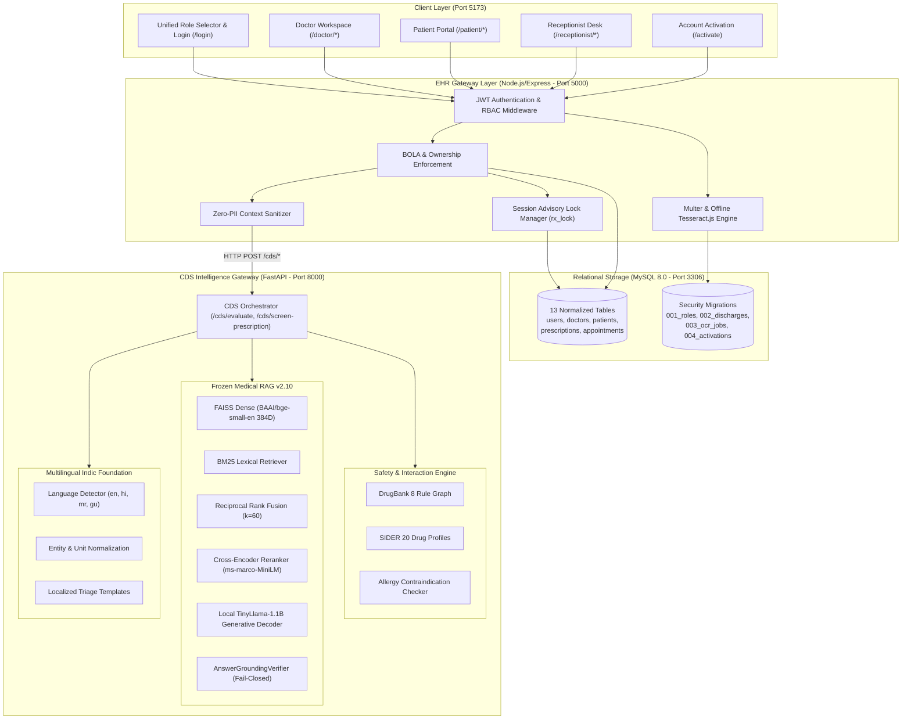
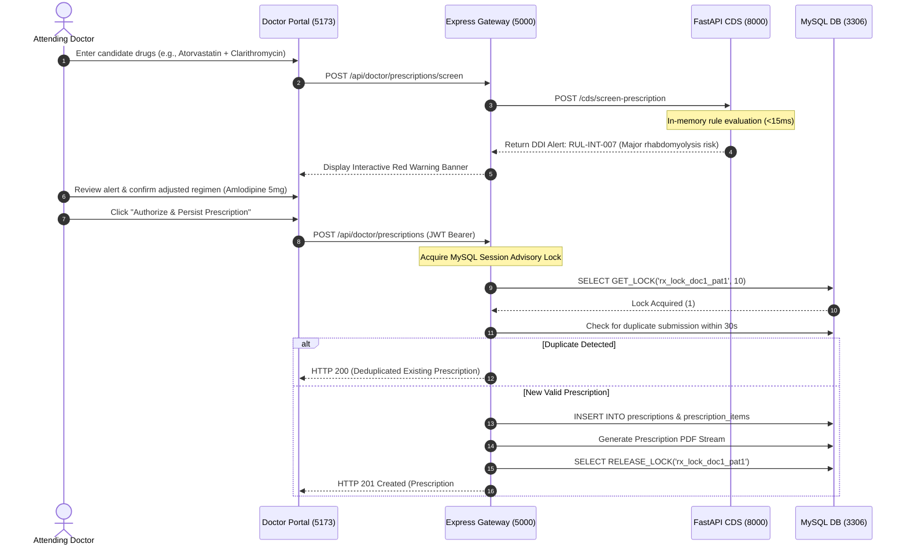
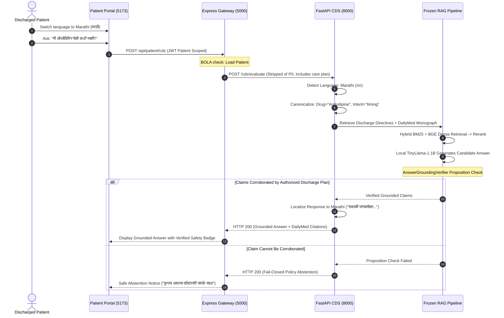
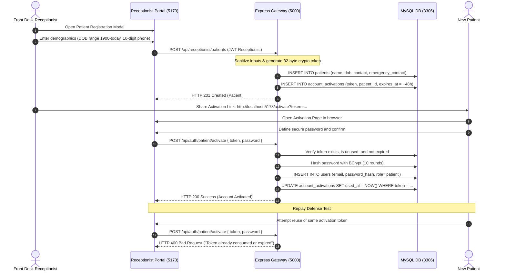

# Modular AI-Powered Multilingual Clinical Decision Support (CDS) System

[](https://www.python.org/)
[](https://nodejs.org/)
[](https://react.dev/)
[](https://vitejs.dev/)
[](https://pytorch.org/)
[](https://github.com/facebookresearch/faiss)
[](https://fastapi.tiangolo.com/)
[](https://expressjs.com/)
[](https://www.mysql.com/)

A production-grade, evidence-grounded **Clinical Decision Support (CDS) System** engineered for clinicians, hospital front-desk personnel, and patients. Built as an advanced 4th-Year Major Engineering Project in Computer Science & Engineering, the platform combines sub-15ms deterministic drug safety engines with a fail-closed Retrieval-Augmented Generation (RAG) intelligence layer, enforcing strict server-side RBAC, request-scoped patient context isolation, authentic biomedical source attribution, and native Indic language support across English, Hindi, Marathi, and Gujarati.

---

## Table of Contents
1. [Project Overview & What the System is Intended For](#1-project-overview--what-the-system-is-intended-for)
2. [How the System Works (Core Subsystems)](#2-how-the-system-works-core-subsystems)
3. [System Architecture & Visual Diagrams](#3-system-architecture--visual-diagrams)
4. [Workflow Sequence Diagrams](#4-workflow-sequence-diagrams)
5. [Concise API Route Matrix](#5-concise-api-route-matrix)
6. [Database Schema & Migrations](#6-database-schema--migrations)
7. [How to Start and Run (Complete Runbook)](#7-how-to-start-and-run-complete-runbook)
8. [Verified Demonstration Script & Test Accounts](#8-verified-demonstration-script--test-accounts)
9. [Automated Test Suites & Empirical Verification](#9-automated-test-suites--empirical-verification)
10. [Known System Limitations & Ethical Scope](#10-known-system-limitations--ethical-scope)

---

## 1. Project Overview & What the System is Intended For

### A. Academic & Clinical Context
This system was developed as a **4th-Year Major Engineering Project** to demonstrate how modern AI architectures can be safely applied to high-stakes healthcare workflows without the life-threatening risks of Large Language Model (LLM) hallucinations.

### B. The Four Clinical Problems Addressed
Modern healthcare delivery suffers from four critical bottlenecks:
1. **Cognitive Overload & Diagnostic Drift**: Clinicians in high-volume hospital environments consult dozens of patients daily, creating fatigue that leads to missed drug-drug interactions or overlooked patient allergies.
2. **Adverse Drug Events (ADEs)**: Preventable medication errors and contraindicated drug combinations represent a leading cause of hospital readmissions and iatrogenic harm globally.
3. **Generative Hallucination in Generic LLMs**: Commercial off-the-shelf LLMs (such as raw ChatGPT or Gemini) generate fluent, persuasive medical answers but hallucinate unverified dosages, non-existent contraindications, or fictional drug entities. In clinical medicine, an unconstrained model is inherently unsafe.
4. **Linguistic Exclusion Post-Discharge**: Patients in multilingual regions (e.g., India) frequently receive discharge summaries in English that they cannot fully understand, resulting in improper medication adherence, missed warning signs, and preventable complications.

### C. What the System IS Intended For
- **Doctor Workflow**: A rapid clinical copilot that performs sub-15ms deterministic drug-drug interaction and allergy screening, provides citation-backed evidence from FDA monographs, enables safe prescription authoring, and generates patient-specific discharge summaries.
- **Patient Workflow**: An accessible post-discharge recovery portal where patients can review verified active prescriptions, read follow-up directives in their preferred language (English, Hindi, Marathi, Gujarati), and ask recovery questions grounded strictly in their doctor's authorized care plan.
- **Receptionist Workflow**: An administrative portal for front-desk patient intake, appointment scheduling, and generation of secure single-use account activation links, with zero access to sensitive clinical records.

### D. What the System IS NOT (Non-Goals & Safety Boundaries)
- **NOT an Autonomous Diagnostician**: The system never replaces licensed medical practitioners. All prescription recommendations require explicit human clinician verification.
- **NOT a Generic Medical Chatbot**: The system will not invent medical answers. If clinical claims cannot be grounded in official DailyMed monographs or the patient's verified discharge plan, it safely abstains (`fail-closed`).
- **NOT a Cleared Medical Device**: This platform is an engineering research prototype and has not undergone formal randomized clinical trials or regulatory clearance (e.g., FDA SaMD or CDSCO).

---

## 2. How the System Works (Core Subsystems)

The platform operates through five decoupled, specialized subsystems that divide fast deterministic rules from deep generative reasoning:

```text
┌────────────────────────────────────────────────────────────────────────────────┐
│                           CORE SUBSYSTEMS OVERVIEW                             │
├───────────────────────┬────────────────────────────────────────────────────────┤
│ 1. Deterministic Rule │ Evaluates multi-drug combinations & patient allergies  │
│    Safety Engine      │ via DrugBank & SIDER graph lookup in < 15 milliseconds.│
├───────────────────────┼────────────────────────────────────────────────────────┤
│ 2. Frozen Medical RAG │ Dual dense/sparse retrieval with RRF, Cross-Encoder    │
│    v2.10 Pipeline     │ reranking, TinyLlama-1.1B, & AnswerGroundingVerifier.  │
├───────────────────────┼────────────────────────────────────────────────────────┤
│ 3. Indic Multilingual │ Canonical entity mapping preserving drug names, doses, │
│    Foundation         │ and negations across English, Hindi, Marathi, Gujarati.│
├───────────────────────┼────────────────────────────────────────────────────────┤
│ 4. Offline Document   │ Client/server image processing with Tesseract.js,      │
│    OCR Pipeline       │ regex extraction, and mandatory clinician review.      │
├───────────────────────┼────────────────────────────────────────────────────────┤
│ 5. Security & Session │ JWT-based RBAC, BOLA defense, session advisory locks,  │
│    Concurrency Layer  │ Zero-PII context sanitization, & single-use tokens.    │
└───────────────────────┴────────────────────────────────────────────────────────┘
```

### 1. Deterministic Medication Safety Engine (`drug_module`)
- **Rule Graph Lookup**: When candidate medications are entered, the engine evaluates drug pairs against curated, high-severity DrugBank interaction rules (`data/rules/medication_interactions/rules.json`) and 20 SIDER drug profiles.
- **Sub-15ms Latency**: Executes synchronously via in-memory lookup tables, returning severity classifications (`major`, `moderate`), mechanism descriptions, and clinical guidance before any prescription can be persisted.
- **Allergy Contraindication Gate**: Compares candidate drugs against the patient's documented allergy list (e.g., `Penicillin`). If a conflict exists, the Express gateway intercepts the request and rejects it with HTTP 422.

### 2. Frozen Evidence-Grounded Medical RAG Pipeline (`rag_module`)
- **Knowledge Base**: 2,204 pre-indexed knowledge chunks (`meta_v2.pkl`, `index_v2.bin`) derived from official FDA DailyMed Structured Product Labels (98.7%), MedlinePlus summaries, and ICMR treatment guidelines.
- **Hybrid Retrieval**:
  - *Dense Semantic*: `BAAI/bge-small-en` (384-dimensional vector embeddings in FAISS).
  - *Sparse Lexical*: Rank-BM25 with token-level clinical matching ($k_1=1.5, b=0.75$).
  - *Fusion*: Reciprocal Rank Fusion (RRF, $k=60$) combining semantic and lexical ranks.
- **Second-Stage Reranker**: `cross-encoder/ms-marco-MiniLM-L-6-v2` scores query-document pairs, assembling the top citations into a 1024-token budget.
- **Local Generation**: `TinyLlama-1.1B-Chat` generates a structured, concise clinical response.
- **Fail-Closed Grounding Verifier (`AnswerGroundingVerifier`)**:
  - Breaks the candidate generation into atomic claims/propositions.
  - Aligns each proposition against retrieved DailyMed chunk citations.
  - If any claim lacks corroboration in the source text, the answer is withheld safely, returning an `abstained_policy` badge.
- **Emergency Triage & Prompt-Injection Guards**:
  - Acute red-flag symptoms (e.g., crushing chest pain, anaphylaxis) trigger instant emergency diversion to national hotlines (**108 / 112**), bypassing generation entirely.
  - Adversarial prompt injection attempts are detected and rejected at the gateway.

### 3. Indic Multilingual Foundation (`multilingual_module`)
- **Supported Languages**: English (`en`), Hindi (`hi`), Marathi (`mr`), and Gujarati (`gu`).
- **Entity-Preserving Canonicalization**: Rather than blindly translating medical text, the pipeline extracts clinical entities (drug name: `Amlodipine`, frequency: `once daily`), temporal modifiers, and intent, mapping them to canonical English representations for retrieval against FDA monographs, and then localizes the response back into the patient's language.

### 4. Prescription Image OCR Pipeline
- **Offline Processing**: Uses local `tesseract.js` with offline trained language data (`eng.traineddata`).
- **Security Validation**: Validates file MIME types and magic bytes (`image/jpeg`, `image/png`) to prevent script execution.
- **Structured Parsing**: Applies clinical regex patterns to extract medication name, strength, dosage form, frequency, and duration.
- **Mandatory Human Review**: Extracted prescriptions are stored with `needs_review: true`. The backend strictly forbids committing OCR prescriptions to active records without explicit clinician sign-off (`POST /api/doctor/prescriptions/confirm-ocr`).

### 5. Security, Concurrency & Data Isolation
- **Role-Based Access Control (RBAC)**: Enforced on every backend route. Administrative accounts (receptionist) cannot access clinical or CDS routes; patients cannot access other patients' dossiers.
- **Broken Object Level Authorization (BOLA) Defense**: All patient endpoints scope queries strictly to the authenticated JWT caller ID, ignoring tampered query parameters or body fields.
- **MySQL Session Advisory Locking (`rx_lock_<docId>_<patId>`)**:
  - High-frequency concurrent submissions acquire a session lock for up to 10 seconds.
  - Guarantees idempotency: identical rapid duplicate submissions result in 1 created record and 4 deduplicated responses, with zero duplicate rows.
  - Lock acquisition timeout fails closed with HTTP 503, leaving zero orphaned rows.
- **Cryptographic Single-Use Account Activation**:
  - Front desk patient intake generates a random 32-byte hex token valid for 48 hours.
  - The patient defines their password via `/activate?token=...`. Once consumed, the token is permanently invalidated, preventing replay attacks.
- **Zero-PII Sanitization**: Express strips all patient demographic identifiers before dispatching clinical queries to FastAPI.

---

## 3. System Architecture & Visual Diagrams

### End-to-End System Topology



---

## 4. Workflow Sequence Diagrams

### A. Doctor Prescribing, Screening & Advisory Lock Lifecycle



### B. Patient Multilingual Post-Discharge Recovery Query



### C. Receptionist Patient Intake & Cryptographic Activation



---

## 5. Concise API Route Matrix

The system exposes 37 verified endpoints across Express and FastAPI:

| Method | Endpoint Path | Owning Service | Auth / Token | Role Scope | Ownership & Safety Policy | Verification Status |
| :--- | :--- | :--- | :--- | :--- | :--- | :---: |
| `GET` | `/health` | Express (5000) | Public | All | Liveness probe and health report | Verified Pass |
| `GET` | `/hub` | Express (5000) | Public | All | Service catalog and public gateway directory | Verified Pass |
| `POST` | `/chat` | Express -> FastAPI (8000) | Public | All | General medical RAG query (Zero PII context) | Verified Pass |
| `GET` | `/ready` | Express -> FastAPI (8000) | Public | All | FAISS index & reranker readiness check | Verified Pass |
| `POST` | `/api/auth/doctor/login` | Express (5000) | Public | Doctor | BCrypt credential verification -> JWT issuance | Verified Pass |
| `POST` | `/api/auth/patient/login` | Express (5000) | Public | Patient | BCrypt credential verification -> JWT issuance | Verified Pass |
| `POST` | `/api/auth/receptionist/login`| Express (5000) | Public | Receptionist | BCrypt credential verification -> JWT issuance | Verified Pass |
| `POST` | `/api/auth/patient/activate` | Express (5000) | Public | Token Bearer | Single-use cryptographic token activation | Verified Pass |
| `GET` | `/api/receptionist/doctors` | Express (5000) | JWT | `receptionist` | Hospital doctor directory listing | Verified Pass |
| `GET` | `/api/receptionist/patients` | Express (5000) | JWT | `receptionist` | Hospital patient demographic roster | Verified Pass |
| `POST` | `/api/receptionist/patients` | Express (5000) | JWT | `receptionist` | Intake registration & single-use token creation | Verified Pass |
| `GET` | `/api/receptionist/appointments` | Express (5000) | JWT | `receptionist` | Appointment schedule listing | Verified Pass |
| `POST` | `/api/receptionist/appointments`| Express (5000) | JWT | `receptionist` | Book patient consultation appointment | Verified Pass |
| `PATCH`| `/api/receptionist/appointments/:id/status`| Express (5000) | JWT | `receptionist` | Update appointment status (checked_in, cancelled) | Verified Pass |
| `GET` | `/api/doctor/profile` | Express (5000) | JWT | `doctor` | Self profile and specialty credentials | Verified Pass |
| `GET` | `/api/doctor/dashboard` | Express (5000) | JWT | `doctor` | Doctor metrics & appointments | Verified Pass |
| `GET` | `/api/doctor/patients` | Express (5000) | JWT | `doctor` | Doctor patient roster | Verified Pass |
| `GET` | `/api/doctor/patients/:patientId` | Express (5000) | JWT | `doctor` | Full clinical history & documented allergies | Verified Pass |
| `POST` | `/api/doctor/prescriptions/screen` | Express -> FastAPI (8000) | JWT | `doctor` | Sub-15ms deterministic DDI & allergy screening | Verified Pass |
| `POST` | `/api/doctor/prescriptions` | Express (5000) | JWT | `doctor` | Advisory lock (`rx_lock_<doc>_<pat>`), allergy gate & save | Verified Pass |
| `GET` | `/api/doctor/prescriptions/:id/pdf` | Express (5000) | JWT | `doctor` | Doctor ownership verification -> PDF stream | Verified Pass |
| `POST` | `/api/doctor/cds` | Express -> FastAPI (8000) | JWT | `doctor` | Grounded clinical RAG with anonymized context | Verified Pass |
| `POST` | `/api/doctor/discharge` | Express (5000) | JWT | `doctor` | Authorize post-discharge instructions & care plan | Verified Pass |
| `GET` | `/api/doctor/patients/:id/discharge` | Express (5000) | JWT | `doctor` | View patient discharge plan | Verified Pass |
| `POST` | `/api/doctor/prescriptions/upload-ocr` | Express (5000) | JWT | `doctor` | Multer magic-byte validation, Tesseract OCR | Verified Pass |
| `GET` | `/api/doctor/prescriptions/ocr-jobs/:id` | Express (5000) | JWT | `doctor` | Review extracted entities (`needs_review: true`)| Verified Pass |
| `POST` | `/api/doctor/prescriptions/confirm-ocr`| Express (5000) | JWT | `doctor` | Mandatory human clinician sign-off & save | Verified Pass |
| `GET` | `/api/patient/profile` | Express (5000) | JWT | `patient` | Self profile data | Verified Pass |
| `GET` | `/api/patient/dashboard` | Express (5000) | JWT | `patient` | Patient portal metrics & upcoming appointments | Verified Pass |
| `GET` | `/api/patient/medical-history` | Express (5000) | JWT | `patient` | Self medical conditions & allergies (BOLA safe) | Verified Pass |
| `GET` | `/api/patient/prescriptions` | Express (5000) | JWT | `patient` | Active & historical prescriptions (Patient scoped)| Verified Pass |
| `GET` | `/api/patient/prescriptions/:id/pdf` | Express (5000) | JWT | `patient` | Patient ownership verification -> PDF stream | Verified Pass |
| `GET` | `/api/patient/discharge` | Express (5000) | JWT | `patient` | View self discharge care plan | Verified Pass |
| `GET` | `/api/patient/appointments` | Express (5000) | JWT | `patient` | View self appointments | Verified Pass |
| `POST` | `/api/patient/cds` | Express -> FastAPI (8000) | JWT | `patient` | Educational assistant grounded in discharge plan| Verified Pass |
| `POST` | `/cds/evaluate` | FastAPI (8000) | Internal | Express | Multi-role clinical intelligence evaluation | Verified Pass |
| `POST` | `/cds/screen-prescription` | FastAPI (8000) | Internal | Express | Sub-15ms deterministic drug interaction check | Verified Pass |

---

## 6. Database Schema & Migrations

The database layer consists of 13 normalized tables in MySQL Server 8.0 (`rag_healthcare`):

```text
┌────────────────────────────────────────────────────────────────────────┐
│                        RELATIONAL DATABASE SCHEMA                      │
├─────────────────────┬──────────────────────────────────────────────────┤
│ users               │ id, email, password_hash, role (doc/pat/rec)     │
│ doctors             │ id, user_id, full_name, specialty, contact       │
│ patients            │ id, user_id, full_name, dob, gender, blood_group │
│ medical_histories   │ id, patient_id, condition_name, allergies, notes │
│ appointments        │ id, patient_id, doctor_id, appointment_date, stat│
│ prescriptions       │ id, doctor_id, patient_id, created_at, notes     │
│ prescription_items  │ id, prescription_id, drug_name, dosage, freq     │
│ doctor_schedules    │ id, doctor_id, day_of_week, start_time, end_time │
│ reports             │ id, patient_id, doctor_id, title, file_url       │
│ followups           │ id, patient_id, doctor_id, scheduled_date, status│
├─────────────────────┼──────────────────────────────────────────────────┤
│                     │ SECURITY & INTEGRATION MIGRATIONS                │
│ discharges          │ (002) id, patient_id, doctor_id, instructions... │
│ prescription_ocr_jobs (003) id, doctor_id, file_path, status, parsed_data │
│ account_activations │ (004) id, patient_id, token, expires_at, used_at │
└─────────────────────┴──────────────────────────────────────────────────┘
```

### Applied Migrations (`migrations/`):
1. `001_add_receptionist_role.sql`: Extends user role enum to include `receptionist`.
2. `002_create_discharges_table.sql`: Creates structured discharge directives, medications, dietary restrictions, and emergency red-flag triggers.
3. `003_create_prescription_ocr_jobs.sql`: Implements OCR processing status (`pending`, `processed`, `confirmed`) with mandatory human clinician review.
4. `004_create_account_activations.sql`: Implements single-use 32-byte cryptographic activation tokens with 48-hour expiration.

---

## 7. How to Start and Run (Complete Runbook)

> [!TIP]
> **Detailed Operator Runbooks**:
> - For a complete, copy-pasteable Windows PowerShell operator guide, see **[`docs/HOW_TO_RUN.md`](file:///E:/Major%20Project%20Code/docs/HOW_TO_RUN.md)**.
> - For role-based clinical scenarios, step-by-step demo guides, and pass/fail checklists, see **[`docs/USER_STORIES_AND_DEMO_WORKFLOWS.md`](file:///E:/Major%20Project%20Code/docs/USER_STORIES_AND_DEMO_WORKFLOWS.md)**.

### A. System Prerequisites
- **Operating System**: Windows 10/11 or Ubuntu 22.04 LTS
- **Node.js**: v20.x or v22.x LTS (`node -v`)
- **Python**: 3.11 or 3.12 with PyTorch (`python --version`)
- **MySQL**: 8.0 or 8.4 Server running on port 3306
- **RAM**: Minimum 8 GB (16 GB recommended for local PyTorch models)

### B. Environment Configuration

1. **Backend Environment** (`Portal Major P/Bhumi/Doctor portal/backend/.env`):
   ```ini
   PORT=5000
   DB_HOST=localhost
   DB_PORT=3306
   DB_USER=root
   DB_PASSWORD=your_mysql_password
   DB_NAME=rag_healthcare
   JWT_SECRET=production_cryptographic_jwt_secret_32bytes_min
   CDS_SERVICE_URL=http://127.0.0.1:8000
   NODE_ENV=development
   ```

2. **Frontend Environment** (`frontend/.env`):
   ```ini
   VITE_API_URL=http://localhost:5000
   ```

### C. One-Command Master Startup (Recommended)

From the project root in PowerShell:
```powershell
powershell -ExecutionPolicy Bypass -File ./scripts/start_platform.ps1
# OR
npm start
```
*The master orchestrator automatically verifies MySQL, starts the FastAPI CDS Gateway (8000), starts the Express EHR Backend (5000), starts the Vite Frontend (5173), verifies health probes, and opens the application in your browser.*

### D. Individual Terminal Startup

```powershell
# Terminal 1: MySQL Server (Port 3306)
& "C:\Program Files\MySQL\MySQL Server 8.0\bin\mysqld.exe" --port=3306 --console

# Terminal 2: FastAPI CDS Gateway & Frozen RAG (Port 8000)
python -m uvicorn rag_module.api:app --host 127.0.0.1 --port 8000

# Terminal 3: Express EHR & Security Gateway (Port 5000)
cd "Portal Major P/Bhumi/Doctor portal/backend"
node server.js

# Terminal 4: Unified React 19 Frontend (Port 5173)
cd "frontend"
npm run dev
```

---

## 8. Verified Demonstration Script & Test Accounts

### Verified Seeded Credentials

| Role | Email | Password | Intended Workflow |
| :--- | :--- | :--- | :--- |
| **Doctor** | `doctor@gmail.com` | `doctor123` | Patient dossier, CDS assistant, DDI screening, prescription authoring, advisory locking, and PDF generation. |
| **Receptionist** | `receptionist@gmail.com` | `receptionist123` | Front-desk intake, patient registration, appointment booking, and activation link creation. |
| **Patient** | `aarav@gmail.com` | `patient123` | Health overview, active prescriptions, discharge directives, and multilingual educational assistant. |

### Live Evaluation Demonstration Steps

#### 0. Direct Doctor Self-Registration (Zero Activation Keys)
1. Open `http://localhost:5173/signup` and select the **Doctor** role tab.
2. Enter clinician details (Name, Email, Password, Specialization, Qualification, Medical License No.).
3. Check the affirmative ethics & academic platform consent checkbox. Click "Create Doctor Account".
   - **Observed Result**: Account is created atomically in MySQL (`users` and `doctors` tables), real JWT session is established, and doctor is redirected directly to `/doctor` without an activation key, token, or manual approval gate.
4. Log out and log in at `http://localhost:5173/login` selecting Doctor role and entering the registered credentials.
   - **Observed Result**: Immediate authenticated login without any secondary code or activation gate.

#### 1. Doctor Prescribing & Instant Safety Alert
1. Open `http://localhost:5173/login` and log in as Doctor (`doctor@gmail.com` / `doctor123`).
2. Navigate to **Patients Dossier** (`/doctor/patients`) and select **Aarav Patil** (Patient #1). Note documented allergy: `Allergy: Penicillin`.
3. Open **Prescriptions** (`/doctor/prescriptions`). In candidate drugs, enter `Atorvastatin` and `Clarithromycin`.
   - **Observed Result**: Instant red banner in **< 15ms**: `RUL-INT-007: Severe risk of rhabdomyolysis and myopathy due to CYP3A4 inhibition`.
4. Attempt to prescribe `Penicillin 500mg`. Click "Authorize Prescription".
   - **Observed Result**: Blocked by server-side safety boundary with HTTP 422: `Prescription rejected due to documented patient allergy`.
5. Enter safe medication: `Amlodipine 5mg Once Daily`. Authorize prescription.
   - **Observed Result**: Persisted successfully (`Rx #101`), deduplicated, and PDF generated.

#### 2. Patient Multilingual Recovery Guidance
1. Log out and log in as Patient (`aarav@gmail.com` / `patient123`).
2. View **Patient Dashboard** (`/patient/dashboard`) — verified Amlodipine prescription is immediately visible.
3. Open **Post-Discharge Assistant** (`/patient/assistant`).
4. Switch global language selector in the top-right header to **मराठी (Marathi)**.
5. Ask: *"मी ॲम्लोडिपिन गोळी कधी घ्यावी?"*
   - **Observed Result**: Verified Marathi response citing patient's authorized discharge care directives: `सकाळी पाण्यासोबत`, bearing the safety badge `Safety Policy Checked (abstained_policy)`.
6. Ask an unsupported question: *"How much Fictitiouzamol should I take?"*
   - **Observed Result**: System safely refuses to invent claims (`fail-closed safe abstention`).

#### 3. Receptionist Registration & Token Activation
1. Log in as Receptionist (`receptionist@gmail.com` / `receptionist123`).
2. Click **Register Patient**. Notice that the modal is fully opaque with dimmed backdrop blur, and dismisses cleanly via `Escape`.
3. Enter patient demographics (DOB `1995-08-20`, Phone `9876543210`). Submit form.
   - **Observed Result**: Success modal presents a single-use link: `http://localhost:5173/activate?token=<hex32>`.
4. Open the link in a browser, define a password, and submit.
   - **Observed Result**: Account activated. Refreshing or submitting again returns HTTP 400 (`Token already consumed`).

---

## 9. Automated Test Suites & Empirical Verification

All test suites have been verified with 100% pass rates across empirical runs:

```powershell
# 1. Master Healthcare CDS Test Suite (All 14 integration & security suites)
node tests/run_all_tests.js

# 2. Route Authorization & BOLA Parameter Tampering Matrix (27 Tests)
node tests/integration/test_route_authorization_matrix.js

# 3. Prescription PDF Ownership & Advisory Lock Timeout Regression (6 Tests)
node tests/integration/test_pdf_ownership_and_lock_failure.js

# 4. Concurrent Prescription Idempotency & Locking Suite (5 Simultaneous Requests)
node tests/integration/test_concurrent_prescription_idempotency.js

# 5. Account Activation & Single-Use Token Isolation Suite (20 Tests)
node scratch/test_activation_and_role_mismatch.js

# 6. Patient Registration Strict Date & Field Validation Suite (9 Tests)
node scratch/test_patient_registration_validation.js

# 7. Frozen RAG Core Regression Suite (190 passed, 2 skipped, 0 failed)
python -m pytest rag_module/tests/ -q

# 8. CDS Gateway Architecture Suite (9 passed)
python -m pytest cds_module/ -v

# 9. Multilingual Indic Foundation Suite (16 passed)
python -m pytest multilingual_module/tests/ -v

# 10. Frontend Production Bundle Compilation (2,245 modules, 0 errors)
cd frontend; npm run build
```

---

## 10. Known System Limitations & Ethical Scope

1. **Academic & Engineering Demonstration Scope**: This software is engineered as a research and engineering project for the 4th-Year Major Engineering Project. It has **not** undergone randomized clinical trials or regulatory medical-device clearance (e.g., FDA SaMD or CDSCO approval) and is intended solely to assist and inform, never replace, the clinical judgment of licensed medical practitioners.
2. **Bounded Deterministic Safety Coverage**: The deterministic interaction engine operates over an auditable set of **8 high-severity DrugBank rules** and **20 SIDER drug profiles** (covering cardiovascular, anticoagulant, NSAID, and antibiotic interactions). Medications outside this curated rule graph are not evaluated by the deterministic engine and rely on RAG retrieval or fail-closed safe abstentions.
3. **Retrieval Knowledge Boundaries**: The production FAISS vector index contains **2,204 validated chunks** (2,176 DailyMed FDA monographs, MedlinePlus summaries, and ICMR guidelines) focusing on common primary care, hypertension, diabetes, and cardiovascular regimens. Inquiries regarding unindexed, experimental, or fictitious entities are safely intercepted by `AnswerGroundingVerifier` and trigger fail-closed policy abstentions (`abstained_policy`).
4. **Local CPU Cold-Start & Generative Latency**:
   - The Cross-Encoder reranker (`cross-encoder/ms-marco-MiniLM-L-6-v2`) requires a lazy-loading cold-start of ~1.5s on its first request after service launch before remaining in-memory.
   - Generative decoding via `TinyLlama-1.1B` on CPU hardware requires 25–30 seconds for deep multi-turn conversational responses. Routine prescription screening avoids this overhead entirely, executing in **< 15 milliseconds** via compiled deterministic graph evaluation.
5. **Prescription Image OCR Review Invariant**: Optical character recognition performed by offline Tesseract.js is treated strictly as an unconfirmed draft (`needs_review: true`). Extracted entities cannot bypass clinician review or be persisted directly to the patient's medical record without explicit confirmation and signature by the attending doctor.
6. **Concurrent Submission Idempotency**: High-frequency concurrent prescription submissions for the same doctor-patient pair are governed by MySQL session advisory locks (`rx_lock_<docId>_<patId>`). If a duplicate request cannot obtain the lock within 10 seconds, it fails closed with HTTP 503, leaving zero orphaned prescription records.

---

**Department of Computer Science & Engineering**
*4th-Year Major Project (2026)*
