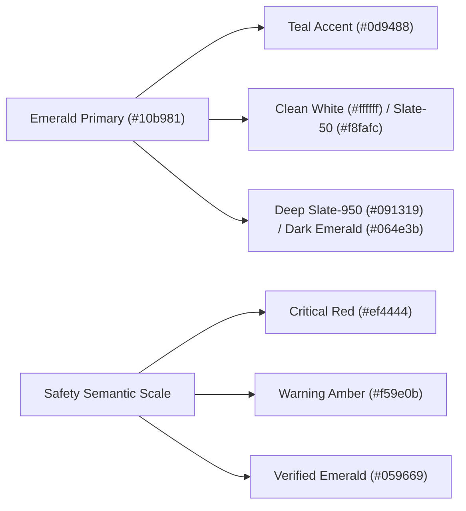
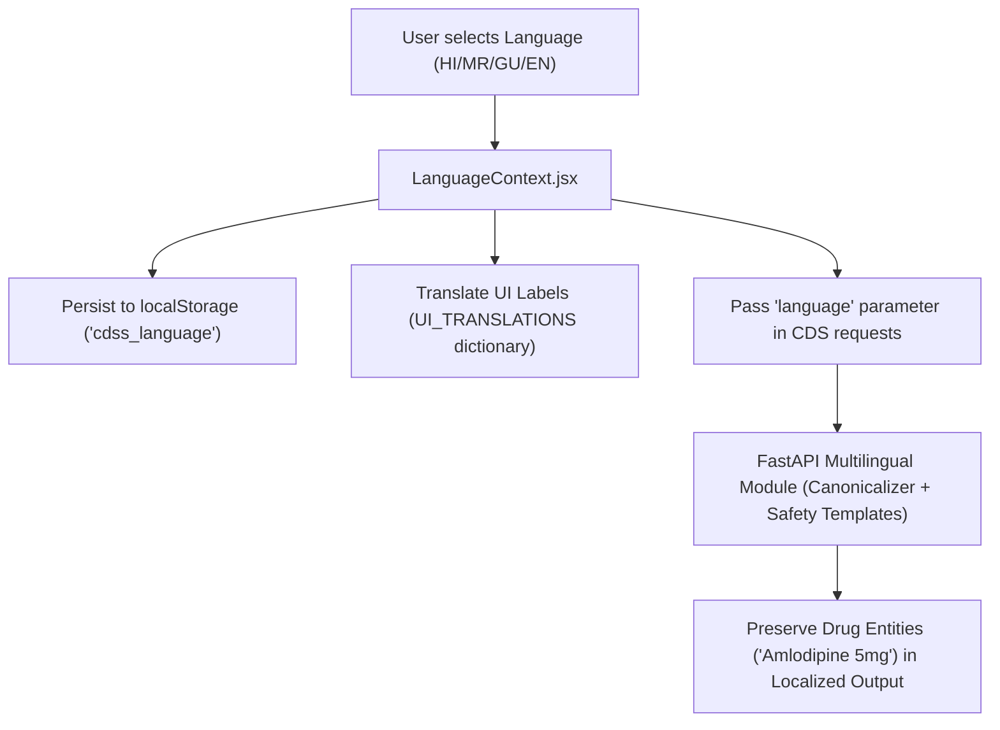

# 01_PRIMARY_FRONTEND_REQUIREMENTS.md — Healthcare CDSS Core Frontend Specification

> **Document Type**: Primary Frontend Architectural & Design Requirements Specification  
> **Project**: Modular AI-Powered Multilingual Clinical Decision Support System (CDSS)  
> **Repository**: `dragyo7/healthcare-System-major-project-`  
> **Target Directory**: `frontend/` (React 19 + Vite 8 SPA on `http://127.0.0.1:5173`)  
> **Specification Version**: 1.0.0 (Authoritative Baseline)  
> **Cross-References**:
> - Detailed Component Specs: [`docs/frontend-spec/02_SECONDARY_COMPONENT_REQUIREMENTS.md`](file:///E:/Major%20Project%20Code/docs/frontend-spec/02_SECONDARY_COMPONENT_REQUIREMENTS.md)
> - User Stories & Workflows: [`docs/frontend-spec/03_USER_STORIES_AND_WORKFLOWS.md`](file:///E:/Major%20Project%20Code/docs/frontend-spec/03_USER_STORIES_AND_WORKFLOWS.md)
> - Project Architecture & Backend Context: [`docs/frontend-spec/04_PROJECT_AND_BACKEND_CONTEXT.md`](file:///E:/Major%20Project%20Code/docs/frontend-spec/04_PROJECT_AND_BACKEND_CONTEXT.md)
> - Authoritative Engineering Manual: [`AGENTS.md`](file:///E:/Major%20Project%20Code/AGENTS.md)
> - Product Acceptance Contract: [`FINAL_GOAL.md`](file:///E:/Major%20Project%20Code/FINAL_GOAL.md)
> - Living Status & Verification Snapshot: [`PROJECT_STATUS.md`](file:///E:/Major%20Project%20Code/PROJECT_STATUS.md)
> - Function-by-Function Flow Map: [`FLOW.md`](file:///E:/Major%20Project%20Code/FLOW.md)

---

## 1. Executive Design Vision & Purpose

The **Clinical Decision Support System (CDSS)** frontend is a clinical-grade, high-reliability web interface engineered to serve three distinct hospital stakeholders: **Physicians / Clinicians**, **Patients**, and **Front-Desk Receptionists**.

### 1.1 Core Design Objectives
1. **Zero Generative Medical Ambiguity**: The UI must visually differentiate between:
   - Verified hospital records (EHR-grounded citations).
   - Generative clinical evidence (DailyMed FDA monograph citations with grounding verification pills).
   - Truthful abstentions (honest disclosures when records or knowledge are absent).
   - Urgent triage / red-flag alerts (emergency medical escalation banners).
2. **Sub-15ms Cognitive Feedback**: Clinical safety gates (Allergy hard-stops, Drug-Drug Interaction alerts) must render immediately upon medication input without blocking the physician's workflow.
3. **Calm, High-Contrast Clinical Palette**: Grounded in a modern emerald-and-white visual aesthetic inspired by clinical reference portals, emphasizing clarity, structural hierarchy, and reduced eye strain during long shifts.
4. **Strict Patient Isolation & Privacy**: The interface must visually confirm caller identity, session role, and authorized patient context at all times, preventing cross-patient confusion or Broken Object Level Authorization (BOLA) leakage.

---

## 2. Visual Design System & Green-and-White Theme

The visual design system draws inspiration from modern healthcare applications, utilizing a curated **emerald, mint, teal, and slate** color palette that balances hospital serenity with high-tech intelligence.

### 2.1 Color Palette & Design Tokens



#### Primary Brand Colors (Emerald Scale)
- `primary-50`: `#ecfdf5` (Lightest tint, active pill backgrounds, badge fills)
- `primary-100`: `#d1fae5` (Light border highlights, hover states)
- `primary-200`: `#a7f3d0` (Card border accents, subtle glows)
- `primary-300`: `#6ee7b7` (Muted accent indicators)
- `primary-400`: `#34d399` (Dark mode icon accents)
- `primary-500`: `#10b981` (Primary CTA buttons, active state indicators)
- `primary-600`: `#059669` (Brand primary, header gradients, primary text links)
- `primary-700`: `#047857` (Pressed button states, high-contrast dark text)
- `primary-800`: `#065f46` (Deep hero background gradients)
- `primary-900`: `#064e3b` (Dark clinical panel fills)
- `primary-950`: `#022c22` (Ultra-dark contrast anchors)

#### Secondary & Neutral Palettes
- **Secondary (Teal / Sage)**:
  - `secondary-50`: `#f0fdf4`
  - `secondary-500`: `#22c55e`
  - `secondary-600`: `#16a34a`
  - `teal-600`: `#0d9488` (Used for Patient Portal workspace accents)
- **Neutrals (Slate)**:
  - `slate-50`: `#f8fafc` (Light mode page background)
  - `slate-100`: `#f1f5f9` (Light mode card headers, muted fills)
  - `slate-200`: `#e2e8f0` (Light mode card borders, divider lines)
  - `slate-400`: `#94a3b8` (Muted caption text, secondary labels)
  - `slate-600`: `#475569` (Body text, icon default fill)
  - `slate-800`: `#1e293b` (Dark mode card background)
  - `slate-900`: `#0f172a` (Dark mode panel background, dark text primary)
  - `slate-950`: `#020617` / `#091319` (Dark mode primary background)

#### Clinical Safety Semantics
- **Critical / Hard-Stop**: `#ef4444` (`destructive`), Background: `#fef2f2`, Dark Background: `#450a0a`. Used exclusively for:
  - Documented Allergy contraindications (`HTTP 422 cannot_override: true`).
  - Emergency triage redirects (Call 108 / 112).
  - Unauthenticated access breaches.
- **Warning / Clinician Review**: `#f59e0b` (`amber-500`), Background: `#fffbeb`, Dark Background: `#451a03`. Used for:
  - Severe Drug-Drug Interactions requiring signed clinical justification.
  - OCR extracted prescriptions flagged with `needs_review: true`.
- **Verified / Safe / Grounded**: `#059669` (`emerald-600`), Background: `#ecfdf5`, Dark Background: `#064e3b`. Used for:
  - Grounded RAG citations with verified DailyMed monograph links.
  - Successfully signed prescriptions with immutable PDF hashes.
  - Verified hospital discharge instructions.
- **Informational / Policy Abstention**: `#3b82f6` (`blue-500`) / `#64748b` (`slate-500`), Background: `#f1f5f9`. Used for:
  - Truthful absence disclosures (e.g., *"No hospital discharge summary on file"*).
  - Educational disclaimers and academic research disclosures.

---

### 2.2 Dark and Light Modes Specification

The platform implements an explicit, persistent theme architecture (`ThemeContext` stored in `localStorage.cdss_theme`).

| Theme Property | Light Mode Specification | Dark Mode Specification | Clinical Justification |
| :--- | :--- | :--- | :--- |
| **Page Background** | `#f8fafc` with subtle emerald radial accents (`rgba(155, 221, 194, 0.38)`) | `#091319` with deep emerald glow (`rgba(16, 185, 129, 0.12)`) | Prevents pure `#000000` pitch-black contrast fatigue; preserves hospital tranquility. |
| **Surface / Cards** | `rgba(255, 255, 255, 0.85)` with `backdrop-blur-xl` and 1px `#e2e8f0` border | `rgba(15, 23, 42, 0.85)` with `backdrop-blur-xl` and 1px `#334155` border | Glassmorphism provides modern elevation while keeping underlying data visible. |
| **Text Primary** | `#0f172a` (Slate-900) — Contrast ratio: 15.8:1 | `#f8fafc` (Slate-50) — Contrast ratio: 16.2:1 | Exceeds WCAG AAA requirement (7:1) for critical medical reading. |
| **Text Secondary** | `#475569` (Slate-600) — Contrast ratio: 7.2:1 | `#94a3b8` (Slate-400) — Contrast ratio: 8.1:1 | High readability for secondary vitals and medication dosage timings. |
| **Inputs / Forms** | White `#ffffff`, border `#cbd5e1`, focus ring `#10b981` | Slate-900 `#0f172a`, border `#334155`, focus ring `#34d399` | Crisp form edges prevent misclicking during fast clinical data entry. |

---

### 2.3 Typography & Spatial System

- **Primary Font Family**: `'DM Sans', 'Inter', system-ui, -apple-system, sans-serif`.
  - Headers / Titles: `'DM Sans'` (Geometric, modern, friendly for patients, authoritative for doctors).
  - Data Tables / Dossier: `'Inter'` with `font-feature-settings: 'tnum'` (tabular figures) so numerical dosages, blood pressures, and timestamps align vertically.
- **Font Scale Hierarchy**:
  - `Display / Hero Title`: 32px / 38px line-height, bold (700)
  - `Page Heading (H1)`: 24px / 30px line-height, bold (700)
  - `Section Heading (H2)`: 18px / 24px line-height, semibold (600)
  - `Card Title (H3)`: 15px / 20px line-height, semibold (600)
  - `Body Text`: 14px / 20px line-height, regular (400) or medium (500)
  - `Microcopy / Badges`: 11px–12px / 16px line-height, semibold (600)
- **Spatial Grid & Elevation**:
  - 8-point spatial rhythm (`8px`, `16px`, `24px`, `32px`, `48px`).
  - Corner Radii:
    - Badges / Small Buttons: `8px` (`rounded-lg`)
    - Cards / Inputs / Modals: `16px` (`rounded-2xl`)
    - Hero Panels / Auth Containers: `24px`–`30px` (`rounded-3xl`)
  - Elevation Shadows:
    - Subtle (Cards): `0 4px 20px rgba(0, 0, 0, 0.04)`
    - Medium (Dropdowns/Modals): `0 12px 35px rgba(0, 0, 0, 0.08)`
    - High (Auth Glass Hero): `0 24px 70px rgba(28, 99, 79, 0.16)`

---

## 3. Role-Based Portal Architecture & Boundaries

The unified frontend on port 5173 serves three authenticated workspaces and a common public shell. Access is strictly governed by server-validated JWT roles (`doctor`, `patient`, `receptionist`).

```text
                                  UNIFIED ENTRY POINT
                                 (http://localhost:5173)
                                            │
               ┌────────────────────────────┼────────────────────────────┐
               ▼                            ▼                            ▼
        DOCTOR PORTAL                PATIENT PORTAL             RECEPTIONIST PORTAL
         (/doctor/*)                  (/patient/*)                (/receptionist/*)
     • Emerald / Indigo           • Emerald / Teal            • Emerald / Slate
     • Prescriptions Studio       • Discharge Directives      • Patient Registration
     • Patient Dossiers           • Educational CDS Copilot   • Appointment Queue
     • Drug Safety Engine         • Medical History           • Doctor Roster
     • Discharge Authoring        • My Prescriptions (PDF)    • Cryptographic Tokens
```

### 3.1 Doctor Clinician Portal (`/doctor/*`)
- **Visual Accent**: Emerald & Deep Indigo.
- **Routes**:
  - `/doctor`: Clinician command center, daily appointments, high-risk patient flags.
  - `/doctor/patients`: Searchable patient dossier directory, documented allergies, medical history.
  - `/doctor/cds`: Interactive Clinical Decision Support Assistant with patient-context injection.
  - `/doctor/prescriptions`: Safe prescription drafting, real-time DDI screening, allergy hard-stops, and OCR prescription ingestion.
  - `/doctor/discharge`: Hospital post-discharge directive authoring with red-flag warning triggers.
  - `/doctor/appointments`: Clinical consultation schedule and status updates.
  - `/doctor/profile`: Professional credentials, license number, and consultation availability.
- **Security Boundary**:
  - Requests must provide `Authorization: Bearer <doc_token>`.
  - Doctor can only access dossiers for patients with whom they have an active clinical appointment or consultation relationship (enforced by Express `isDoctorAuthorizedForPatient`).
  - Unauthorized access attempts return HTTP 403 Forbidden with zero patient clinical data returned.

### 3.2 Patient Self-Service Portal (`/patient/*`)
- **Visual Accent**: Emerald & Soothing Teal.
- **Routes**:
  - `/patient`: Personal health dashboard, active medications, upcoming visits, emergency banner.
  - `/patient/discharge`: Post-discharge instructions, dietary restrictions, warning triggers.
  - `/patient/assistant`: Educational Post-Discharge Assistant grounded in the patient's authorized discharge summary.
  - `/patient/prescriptions`: Active and past clinician-ordered prescriptions with real-time PDF download.
  - `/patient/history`: Personal diagnoses, vitals timeline, and documented allergies.
  - `/patient/appointments`: Book consultations, view doctor availability, cancel upcoming appointments.
  - `/patient/profile`: Personal contact info, address, and emergency contact details.
- **Security Boundary**:
  - Requests must provide `Authorization: Bearer <pat_token>`.
  - Server strictly resolves patient identity from `req.user.user_id`. Parameter tampering (e.g. submitting another patient's ID in `/api/patient/cds`) is intercepted with HTTP 403 Forbidden.
  - Zero access to other patients' records or doctor CDS tools.

### 3.3 Receptionist Administrative Front Desk (`/receptionist/*`)
- **Visual Accent**: Emerald & Balanced Slate.
- **Routes**:
  - `/receptionist`: Front-desk queue overview, today's check-ins, doctor roster status.
  - `/receptionist/patients`: Patient intake registration and cryptographic activation token generation.
  - `/receptionist/appointments`: Hospital-wide consultation queue, check-in, confirmation, cancellation.
  - `/receptionist/doctors`: Clinic doctor directory, department roster, and consultation timings.
- **Security Boundary**:
  - Requests must provide `Authorization: Bearer <rec_token>`.
  - **Zero Clinical Privilege**: Receptionist accounts cannot view clinical diagnoses, prescriptions, discharge instructions, or access CDS endpoints. Attempting to call clinical APIs returns HTTP 403 Forbidden.

### 3.4 Common & Authentication Shell
- `/login`: 2-column CareUnity layout with 3 role tabs (`[♡ Patient]`, `[▦ Receptionist]`, `[✚ Doctor]`), inline Sign-in/Sign-up toggle, and 1-click synthetic demo profiles.
- `/signup`: Patient self-registration with mandatory informed consent checkbox and link to clinical ethics disclaimers.
- `/activate`: Cryptographic single-use token activation page (`/activate?token=<32_byte_token>`) for newly onboarded walk-in patients.
- `/about`: 10-section academic ethics, model limitations, SaMD disclaimer, emergency triage guidance (108/112), and open-source licensing page.
- `/unauthorized` & `/404`: Friendly, non-leaking error screens with quick navigation home.

---

## 4. Top Header & Navigation Paradigm

```text
┌────────────────────────────────────────────────────────────────────────────────────────────────────────┐
│ [CDSS Logo] CDSS Healthcare | 🩺 Clinician Workspace      [Dr. Rahul Sharma] [🌐 EN ▼] [☀️/🌙] [Logout]│
├──────────────┬─────────────────────────────────────────────────────────────────────────────────────────┤
│ 📊 Dashboard │ Main Content Viewport                                                                   │
│ 👥 Patients  │                                                                                         │
│ ✨ CDS AI    │                                                                                         │
│ 💊 Rx Safety │                                                                                         │
│ 📄 Discharge │                                                                                         │
│ 📅 Schedule  │                                                                                         │
│ 👤 Profile   │                                                                                         │
└──────────────┴─────────────────────────────────────────────────────────────────────────────────────────┘
```

### 4.1 Header Bar Specification
- **Height**: 64px (`h-16`), sticky at top (`sticky top-0 z-30`), glassmorphic background with `backdrop-blur-xl`.
- **Brand Element**: High-contrast emerald badge (`CDSS`), application name, and subtitle (*Clinical Intelligence Platform*).
- **Workspace Badge**: Displays current active role with distinct icon and badge color:
  - Doctor: `🩺 Clinician Workspace` (Emerald/Indigo)
  - Patient: `🏥 Patient Care Portal` (Teal)
  - Receptionist: `📋 Administrative Front Desk` (Slate)
- **Controls Group**:
  - User identity pill (Name and Email).
  - Multilingual Selector dropdown (`EN`, `HI`, `MR`, `GU`).
  - Dark/Light mode toggle button (Sun/Moon icon).
  - Logout button with session clearance.

### 4.2 Sidebar Navigation Specification
- **Desktop ($\ge 1024px$)**: Fixed left sidebar, width 260px (`w-64`), with custom scrollbar, active link emerald highlight pill, and role-specific icons (via `lucide-react`).
- **Mobile ($< 1024px$)**: Hidden by default; toggled via hamburger menu button in header. Slides in as an off-canvas drawer with backdrop overlay. Tapping any navigation link or backdrop automatically closes the drawer.

---

## 5. Responsive Layout Architecture

The frontend must adapt smoothly across all screen sizes without horizontal scrolling or clipped clinical data.

| Viewport Category | Screen Width Range | Layout Adaptation Rules |
| :--- | :--- | :--- |
| **Mobile** | `< 640px` (e.g. 375x812 iPhone) | • Sidebar collapses to hamburger off-canvas drawer.<br>• 2-column Auth page stacks vertically (Welcome hero on top, Form card below).<br>• Clinical dossier tabs convert to horizontal scrollable pills.<br>• Prescription authoring shifts from side-by-side to stacked sections.<br>• Data tables collapse into stacked card lists. |
| **Tablet** | `640px` – `1023px` | • Grid displays 2 columns for dashboard metric cards.<br>• Modals span 90% viewport width.<br>• Sidebar remains collapsed under drawer. |
| **Desktop** | `1024px` – `1439px` | • Persistent 260px left sidebar.<br>• Dashboard displays 3–4 metric cards per row.<br>• Prescription Studio displays candidate medications on left, live safety screen alerts on right. |
| **Wide Desktop** | `$\ge 1440px$` | • Centered layout max-width 1600px with fluid margins.<br>• Multi-column patient dossiers (Vitals + Diagnoses + Rx History side-by-side). |

---

## 6. Multilingual Architecture (`en`, `hi`, `mr`, `gu`)

The frontend supports English, Hindi, Marathi, and Gujarati across all interfaces, governed by [`frontend/src/contexts/LanguageContext.jsx`](file:///E:/Major%20Project%20Code/frontend/src/contexts/LanguageContext.jsx).



### 6.1 Translation Rules & Standards
1. **Clinical Entity Preservation**: Drug names (e.g., `Metformin`, `Amlodipine`), numerical dosages (`500mg`, `5mg`), and frequency abbreviations (`OD`, `BD`, `TID`) **must never be phonetically corrupted or translated into vernacular terms**.
2. **Safety Notice Localization**: Emergency notices (e.g., *"If you experience chest pain, immediately call 108/112"*) must be rendered in accurate, pre-verified regional phrasing across Hindi, Marathi, and Gujarati.
3. **Instant UI Switching**: Switching the language selector updates the entire interface instantly without requiring a page reload.

---

## 7. Accessibility (WCAG 2.1 AA/AAA) & Clinical Safety Standards

In a clinical decision support system, UI design is a matter of patient safety.

1. **Color Independence**: Color is never the sole indicator of clinical risk. Every alert must pair color with an explicit textual label and icon (e.g., Red + 🛑 + `CRITICAL CONTRAINDICATION`).
2. **Fail-Closed Presentation**: If a network error, timeout, or server failure occurs during an AI inquiry or safety check, the UI must:
   - Display an explicit warning banner: *"Clinical Safety Screen Unavailable"*.
   - Prohibit the clinician from assuming that zero alerts equals safe prescribing.
   - Never display internal model verifier codes (`[INVALID_CITATION]`, tracebacks) to patients.
3. **Emergency Prominence**: Patient interfaces must persistently display the national emergency ambulance numbers (**108 / 112**) in prominent red-accented cards on both the Dashboard and Post-Discharge views.
4. **Keyboard Operability**: All interactive clinical elements (modal dialogs, prescription confirmation buttons, patient search) must be accessible via keyboard (`Tab`, `Enter`, `Escape`).

---

## 8. Summary Checklist for Implementation Readiness

- [x] Visual tokens match CareUnity emerald/mint palette with light and dark mode variables.
- [x] Responsive layout collapses smoothly from 1600px down to 375px mobile viewports.
- [x] Three role-based portals have strict route guards and visual identity indicators.
- [x] Multilingual context supports `en`, `hi`, `mr`, `gu` with entity preservation rules.
- [x] WCAG AA/AAA contrast ratios and color-independent clinical alerts specified.
