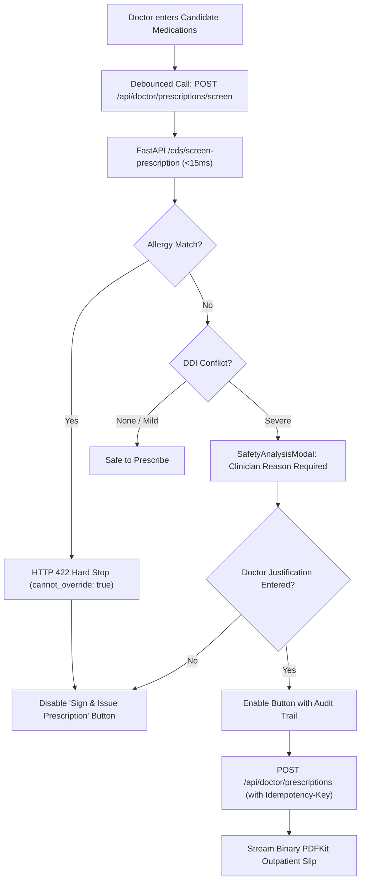

# 02_SECONDARY_COMPONENT_REQUIREMENTS.md — Healthcare CDSS Component Specification

> **Document Type**: Detailed Secondary Component Requirements & Technical Interface Specification  
> **Project**: Modular AI-Powered Multilingual Clinical Decision Support System (CDSS)  
> **Repository**: `dragyo7/healthcare-System-major-project-`  
> **Target Directory**: `frontend/src/components/`, `frontend/src/pages/`  
> **Specification Version**: 1.0.0 (Authoritative Baseline)  
> **Cross-References**:
> - Core Frontend Requirements: [`docs/frontend-spec/01_PRIMARY_FRONTEND_REQUIREMENTS.md`](file:///E:/Major%20Project%20Code/docs/frontend-spec/01_PRIMARY_FRONTEND_REQUIREMENTS.md)
> - User Stories & Workflows: [`docs/frontend-spec/03_USER_STORIES_AND_WORKFLOWS.md`](file:///E:/Major%20Project%20Code/docs/frontend-spec/03_USER_STORIES_AND_WORKFLOWS.md)
> - Project Architecture & Backend Context: [`docs/frontend-spec/04_PROJECT_AND_BACKEND_CONTEXT.md`](file:///E:/Major%20Project%20Code/docs/frontend-spec/04_PROJECT_AND_BACKEND_CONTEXT.md)
> - Function-by-Function Flow Map: [`FLOW.md`](file:///E:/Major%20Project%20Code/FLOW.md)
> - Living Status & Verification Snapshot: [`PROJECT_STATUS.md`](file:///E:/Major%20Project%20Code/PROJECT_STATUS.md)

---

## 1. Global Component Architecture & Atomic Design

The CDSS frontend is organized into a modular Atomic Component Hierarchy that strictly separates presentation from clinical data fetching and safety verification.

```text
src/
├── components/
│   ├── ui/             # Atoms: Base primitives (Button, Input, Select, Badge, Loader)
│   ├── shared/         # Molecules: Domain-agnostic patterns (Modal, StatCard, EmptyState, PageHeader)
│   ├── layout/         # Organisms: Structural frames (Sidebar, Header, Navigation)
│   ├── doctor/         # Clinical Organisms: Dossier, PatientSearchSelector, SafetyAnalysisModal
│   ├── chat/           # Conversational Organisms: ChatBox, ChatMessage, CitationPill
│   └── forms/          # Form Templates: LoginForm, SignupForm, PrescriptionForm
└── pages/              # Templates / Views: Assembled clinical workspaces
```

---

## 2. Core Reusable UI Atoms & Molecules

### 2.1 Buttons (`components/ui/Button.jsx`)
- **Variants**:
  - `primary`: Emerald gradient (`from-emerald-600 to-teal-600`), white text, subtle shadow, active scale `0.98`.
  - `secondary`: Slate-100 dark:slate-800, border slate-200 dark:slate-700, slate-700 dark:slate-200 text.
  - `danger` / `destructive`: Red-600, white text, red focus ring. Used for appointment cancellation or clearing draft prescriptions.
  - `outline`: Transparent background, 1.5px emerald-600 border, emerald text, hover:bg-emerald-50 dark:hover:bg-emerald-950/40.
  - `ghost`: Transparent background, hover:bg-slate-100 dark:hover:bg-slate-800.
- **States**: `default`, `hover`, `active`, `disabled` (`opacity-50 cursor-not-allowed pointer-events-none`), `loading` (inline spinning ring replacing icon).
- **Accessibility**: Enforces `aria-disabled` and clear focus ring (`focus:ring-2 focus:ring-emerald-500 focus:ring-offset-2`).

### 2.2 Form Inputs & Controls (`components/ui/Input.jsx`)
- **Variants**: Text input, Number input, Date picker, Textarea, Dropdown Select.
- **Design**: Rounded-xl (`12px`), 1px border (`border-slate-200 dark:border-slate-700`), transition on focus to `border-emerald-500 ring-2 ring-emerald-500/20`.
- **Validation Presentation**: Inline red caption text (`text-xs text-red-500 mt-1`) with error icon (`AlertCircle`).
- **Date Restrictions**: Registration DOB picker explicitly restricts `max={new Date().toISOString().split('T')[0]}` and `min="1900-01-01"` to prevent invalid calendar entries.

### 2.3 Badges & Severity Indicators (`components/ui/Badge.jsx`)
- **Clinical Severity Scale**:
  - `critical`: `bg-red-50 text-red-700 border-red-200 dark:bg-red-950/50 dark:text-red-400 dark:border-red-900/50` (Icon: 🛑 `AlertOctagon`).
  - `warning`: `bg-amber-50 text-amber-800 border-amber-200 dark:bg-amber-950/50 dark:text-amber-400 dark:border-amber-900/50` (Icon: ⚠️ `AlertTriangle`).
  - `safe` / `grounded`: `bg-emerald-50 text-emerald-800 border-emerald-200 dark:bg-emerald-950/50 dark:text-emerald-400 dark:border-emerald-900/50` (Icon: 🛡️ `ShieldCheck`).
  - `info`: `bg-blue-50 text-blue-800 border-blue-200 dark:bg-blue-950/50 dark:text-blue-400 dark:border-blue-900/50` (Icon: ℹ️ `Info`).
  - `neutral` / `synthetic`: `bg-slate-100 text-slate-700 border-slate-200 dark:bg-slate-800 dark:text-slate-300 dark:border-slate-700`.

### 2.4 Modals & Confirmation Dialogs (`components/shared/Modal.jsx`, `ConfirmationDialog.jsx`)
- **Structure**: Backdrop (`bg-slate-900/60 backdrop-blur-sm`), centered card with max-width (`max-w-lg` or `max-w-3xl`), sticky header with close (`X`) button, scrollable body (`max-h-[75vh] overflow-y-auto`), footer action bar.
- **Keyboard Handling**: Pressing `Escape` closes modal; auto-focuses primary button on open; trap focus inside dialog.

### 2.5 Empty, Loading & Error States
- **Loading Skeletons (`components/shared/LoadingScreen.jsx`, `LoadingSpinner.jsx`)**: Animated pulse placeholder cards matching exact dimensions of final clinical cards to eliminate layout shift (CLS < 0.05).
- **Empty State (`components/shared/EmptyState.jsx`)**: Centered icon in circular muted emerald bubble, bold title, descriptive subtitle, and clear Call-To-Action button (e.g. *"No Active Prescriptions"*, *"Schedule New Consultation"*).
- **Error State (`components/shared/ErrorBoundary.jsx`)**: Catch runtime render errors, display non-technical guidance with a *"Retry Connection"* button, and report the configured API base URL without exposing stack traces.

---

## 3. Clinical Dashboards Specification

### 3.1 Doctor Clinician Dashboard (`pages/Doctor/Dashboard.jsx`)
- **Metric Cards (Row 1)**:
  - Total Assigned Patients (Live count from `GET /api/doctor/dashboard`).
  - Today's Appointments (Pending, Completed, Cancelled).
  - Active Prescriptions Authored (30-day window).
  - High-Risk Patients (Documented severe allergies or active DDI monitoring).
- **Consultation Queue Table (Row 2)**:
  - Columns: Time, Patient Name, Age/Gender, Reason for Visit, Status Badge (`Requested`, `Confirmed`), Action (`Open Dossier`, `Start CDS`).
- **Quick Patient Dossier Switcher**:
  - Auto-completing search input to immediately load any authorized patient dossier without leaving the dashboard.

### 3.2 Patient Health Dashboard (`pages/Patient/Dashboard.jsx`)
- **Emergency Red-Flag Card (Top Anchor)**:
  - Prominent banner: *"Experiencing severe chest pain, shortness of breath, or sudden weakness? Immediately call national emergency services: 108 / 112."*
- **Active Post-Discharge Care Summary (Row 1)**:
  - Shows latest hospital discharge summary, primary discharge diagnosis, and direct bridge button: `Ask Recovery Assistant 💬`.
- **Current Active Medications (Row 2)**:
  - List of active clinician-ordered prescriptions with dosage, frequency, prescriber name, and direct PDF download button.
- **Next Scheduled Appointment (Row 3)**:
  - Doctor name, specialty, date, time slot, status, and *"Cancel Request"* action.

### 3.3 Receptionist Administrative Dashboard (`pages/Receptionist/Dashboard.jsx`)
- **Front-Desk Metric Cards (Row 1)**:
  - Today's Patient Influx (Checked-in vs. Awaiting).
  - Pending Online Appointment Requests.
  - Active Doctors on Duty (Live roster count).
  - Total Registered Patients in Directory.
- **Live Consultation Scheduling Queue (Row 2)**:
  - Real-time list of hospital consultations. Actions: `Confirm`, `Check-In`, `Mark Completed`, `Cancel`.
- **Fast Walk-in Registration CTA**:
  - One-click button opening walk-in patient intake modal with automatic single-use activation token generation.

---

## 4. Patient Clinical Dossier & Search (`pages/Doctor/Patients.jsx`)

```text
┌────────────────────────────────────────────────────────────────────────────────────────┐
│ [🔍 Search Patient by Name, ID, or Phone...]  [Filter: All / Cardiac / Diabetic ▼]    │
├────────────────────────────────────────────────────────────────────────────────────────┤
│ Patient: Aarav Patil (ID: 1) | Male, 54y | Blood: B+ | Allergies: 🛑 PENICILLIN        │
├────────────────────────────────┬───────────────────────────────────────────────────────┤
│ Active Conditions              │ Medication History                                    │
│ • Heart Failure (NYHA Class II)│ • Furosemide 40mg Daily (Started 2026-09-15)          │
│ • Hypertension (Essential)     │ • Lisinopril 10mg Daily (Started 2026-09-15)          │
├────────────────────────────────┼───────────────────────────────────────────────────────┤
│ Recent Vitals                  │ Discharge Directives                                  │
│ • BP: 132/84 mmHg              │ • Authorized: 2026-10-12 by Dr. Sharma                │
│ • Pulse: 72 bpm | SpO2: 98%    │ • Strict low-sodium diet (<2g/day)                    │
└────────────────────────────────┴───────────────────────────────────────────────────────┘
```

### 4.1 Patient Search & Selector (`components/doctor/PatientSearchSelector.jsx`)
- **Functionality**:
  - Debounced input searching `/api/doctor/patients?search=...`.
  - Dropdown displays Patient Name, Age, Gender, and documented allergies.
  - Selecting a patient immediately loads their clinical dossier, active prescriptions, conditions, and discharge history.
- **Context Isolation & State Guard (DEC-043 Invariant)**:
  - Switching patients immediately increments an internal request generation counter (`activeRequestId`).
  - Aborts any in-flight CDS or RAG requests for the previous patient.
  - Clears prior analysis, draft prescriptions, and chat history to **prevent stale cross-patient data bleeding**.

### 4.2 Documented Allergies High-Visibility Callout
- Any documented patient allergy (e.g. `Penicillin`, `Aspirin`, `Sulfa`) renders in a persistent bold red pill:
  ```jsx
  <span className="inline-flex items-center gap-1.5 px-3 py-1 rounded-full text-xs font-bold bg-red-100 text-red-800 border border-red-300 dark:bg-red-950 dark:text-red-300">
    <AlertOctagon className="w-3.5 h-3.5 text-red-600" />
    ALLERGY: {allergy.toUpperCase()}
  </span>
  ```

---

## 5. Prescription Studio, Safety Gate & PDF Streaming

The Prescription Studio (`pages/Doctor/Prescriptions.jsx`) provides safe medication drafting with integrated sub-15ms deterministic safety verification.



### 5.1 Prescription Creation Form
- **Form Fields**:
  - `medicine_name`: Text with clinical autocomplete from DrugBank/DailyMed formulary.
  - `dosage`: e.g., `500mg`, `10mg`, `2.5ml`.
  - `frequency`: Dropdown (`Once daily (OD)`, `Twice daily (BD)`, `Thrice daily (TID)`, `Four times daily (QID)`, `As needed (PRN)`).
  - `duration`: e.g., `7 days`, `30 days`, `Ongoing`.
  - `instructions`: e.g., `Take after meals with a full glass of water`.
- **Dynamic Medication List**:
  - Clinician can add multiple medications to a draft prescription table before committing.

### 5.2 Real-Time Deterministic Drug Safety Screen
- As medications are added or edited, the frontend dispatches `POST /api/doctor/prescriptions/screen` with `{ patient_id, candidate_medications }`.
- **Allergy Hard-Stop Presentation**:
  - If a candidate medication matches the patient's documented allergy (e.g. `Amoxicillin` for a patient allergic to `Penicillin`), the UI displays an **immovable red alert banner**:
    > **🛑 ALLERGY CONTRAINDICATION (HARD STOP)**  
    > Patient has a documented allergy to **Penicillin**, which is cross-reactive with **Amoxicillin**.  
    > *Safety Policy: This prescription cannot be overridden. Selection must be removed.*
  - The "Sign & Issue Prescription" button is **completely disabled**.
- **Drug-Drug Interaction Modal (`components/doctor/SafetyAnalysisModal.jsx`)**:
  - If a severe interaction is detected (e.g., `Atorvastatin` + `Clarithromycin` $\rightarrow$ Rhabdomyolysis risk `RUL-INT-007`):
    - Triggers the `SafetyAnalysisModal`.
    - Displays mechanism of interaction, clinical severity, and suggested alternative medications (with explicit DailyMed evidence provenance).
    - Requires the physician to check an affirmative acknowledgment: `[x] I have reviewed the interaction risk and clinically justify proceeding:` and provide a written rationale (`safety_override_reason`).

### 5.3 Concurrency & Idempotency Header
- Submissions include a UUIDv4 `Idempotency-Key` header (`doctorApi.createPrescription(data, uuid)`).
- Rapid double-clicks are absorbed by Express MySQL session advisory locks (`rx_lock_<doc>_<pat>`), preventing duplicate prescription entries.

### 5.4 Binary PDF Streaming & Viewer
- Upon successful submission, the UI provides a `"Download Official Prescription PDF"` button.
- Invokes `doctorApi.downloadPrescriptionPDF(id)` or `patientApi.downloadPrescriptionPDF(id)`:
  - Fetches binary `%PDF-` stream using authenticated Bearer token.
  - Converts stream to local blob URL (`window.URL.createObjectURL(blob)`).
  - Triggers browser download or preview with filename: `Prescription_#<id>_<PatientName>.pdf`.
  - BOLA Defense: Unauthorized users attempting to fetch another patient's PDF receive HTTP 403 with **zero bytes streamed**.

### 5.5 Prescription Image OCR Ingestion Pipeline
- **Upload Component**: Drag-and-drop box accepting JPEG/PNG images $\le 10\text{MB}$.
- **Client-Side Validation**: Checks magic bytes (`\xFF\xD8\xFF` for JPEG, `\x89\x50\x4E\x47` for PNG) before dispatching.
- **Offline Tesseract.js Job Tracking**:
  - Displays progress bar while server executes auto-orientation deskewing and OCR text extraction.
  - Polling `GET /api/doctor/prescriptions/ocr-jobs/:id` until status reaches `completed`.
- **Mandatory Clinician Confirmation Modal**:
  - Displays original image alongside extracted text and structured candidate table.
  - Every extracted drug is tagged `needs_review: true`.
  - **Invariant**: Prescription data **cannot enter MySQL records** until the clinician explicitly edits/confirms each row and clicks `"Approve & Sign OCR Prescription"`.

---

## 6. Post-Discharge Care Plan & Educational Assistant

### 6.1 Doctor Discharge Authoring Form (`pages/Doctor/Discharge.jsx`)
- **Required Fields**:
  - `discharge_diagnosis`: Authoritative diagnosis at release (e.g., *Acute Decompensated Heart Failure (Stabilized)*).
  - `discharge_instructions`: General recovery directives, activity restrictions, and wound dressing instructions.
  - `dietary_instructions`: e.g., *Strict low-sodium diet (<2g/day), fluid restriction to 1.5L/day*.
  - `warning_signs`: Emergency red-flag symptoms requiring immediate hospital return (e.g., *Weight gain >2kg in 48h, worsening shortness of breath*).
  - `follow_up_date`: Date and clinic department for follow-up evaluation.
- Commits via `POST /api/doctor/discharge`.

### 6.2 Patient Post-Discharge Directive Viewer (`pages/Patient/Discharge.jsx`)
- Renders the authorized discharge summary in clean, accessible cards:
  - Diagnosis Banner with physician credentials and timestamp.
  - Medication Administration Regimen.
  - Diet & Lifestyle Directives.
  - Emergency Warning Signs (highlighted in red card with 108/112 quick dial).
  - Follow-up Appointment Date with calendar add button.

### 6.3 Patient Post-Discharge Recovery Assistant (`pages/Patient/Assistant.jsx`)
- **Architectural Flow**:
  - Patient asks natural questions (e.g. *"What care should I take?"*, *"When do I take my heart medicine?"*, *"Can I eat salt?"*).
  - Express loads the patient's authenticated discharge summary and active prescriptions, sanitizes PII, and forwards to FastAPI `/cds/evaluate`.
  - FastAPI evaluates recovery queries against the **authorized discharge summary first** (`pipeline_mode: "discharge_care_grounding"`).
  - **Honest Absence Disclosure**: If the patient has no saved discharge summary on file, the assistant returns an honest message with 0 citations:
    > *"No hospital discharge summary or post-discharge care directives are documented in your electronic health record. Please consult your treating care team for post-hospitalization instructions."*
  - **Zero Verifier Leaks**: Internal diagnostics (`[INVALID_CITATION]`, tracebacks) are stripped; patient only sees clean, reassuring, fail-closed clinical advice.

---

## 7. Clinical Decision Support (CDS) Assistant (`pages/Doctor/CDS.jsx`)

The Doctor CDS Assistant provides an AI copilot grounded in the frozen DailyMed knowledge base (2,204 chunks) with strict fail-closed verification.

```text
┌────────────────────────────────────────────────────────────────────────────────────────┐
│ Context: Patient #1 (Aarav Patil - HF, HTN)  [Mode: Hybrid RAG (BM25 + Dense) ▼]      │
├────────────────────────────────────────────────────────────────────────────────────────┤
│ 👨‍⚕️ Clinician: What is the maximum recommended dose of Metformin in renal impairment?  │
│                                                                                        │
│ 🤖 CDSS Copilot:                                                                       │
│ Metformin is contraindicated in patients with severe renal impairment (eGFR <30       │
│ mL/min/1.73 m²). For eGFR 30–45 mL/min/1.73 m², maximum recommended dose is 1000mg    │
│ daily with frequent monitoring of renal function.                                      │
│                                                                                        │
│ 🏷️ Verification: [✅ Grounded]  [Model: TinyLlama-1.1B]  [Latency: 1.2s]               │
│ 📚 Citations (2):                                                                      │
│   [1] DailyMed FDA Monograph — Metformin HCl (Package Label)                          │
│   [2] ICMR Guidelines for Type 2 Diabetes Management                                  │
└────────────────────────────────────────────────────────────────────────────────────────┘
```

### 7.1 Key Technical Components
- **Citation Pills (`components/chat/CitationPill.jsx`)**: Clickable badges showing document source (`DailyMed`), section (`Dosage and Administration`), and FDA monograph ID.
- **Grounding Status Badges**:
  - `grounded`: Green badge (`Grounded Answer`).
  - `partially_grounded`: Blue badge (`Partially Verified`).
  - `withheld_verification_failure`: Amber badge (`Safety Policy Checked — Answer Withheld Fail-Closed`). Citations cleared.
- **Triage Interception Banner**: If the query contains emergency triggers (e.g., *"patient having massive chest pain and fainting"*), the assistant bypasses generation and immediately renders the **Emergency Red-Flag Interception Card**.

---

## 8. Forms, Data Tables & Input Modals

### 8.1 Data Tables (`components/shared/DataTable.jsx`)
- Column sorting (click header to toggle ascending/descending/off).
- Real-time search filter across multiple text fields.
- Pagination controls (`Previous`, `Page 1 of N`, `Next`).
- Responsive Card Reflow: Automatically switches from `<table>` to stacked card viewports when width falls below `640px`.

### 8.2 Confirmation & Danger Dialogs
- Deleting an appointment or schedule slot requires explicit two-step confirmation via `ConfirmationDialog`.
- Destructive buttons require holding or typing a confirmation phrase for high-impact actions.

---

## 9. Comprehensive Component Inventory Table

| Component Identifier | File Location | Primary Role / Audience | Key Functional Responsibilities |
| :--- | :--- | :--- | :--- |
| `Button` | `components/ui/Button.jsx` | Universal | Primary/Secondary/Danger action buttons with loading spinner. |
| `Input` | `components/ui/Input.jsx` | Universal | Validated form inputs with error tooltips and date constraints. |
| `Badge` | `components/ui/Badge.jsx` | Universal | Severity tags: Critical (red), Warning (amber), Safe (green). |
| `Modal` | `components/shared/Modal.jsx` | Universal | Accessible dialog wrapper with backdrop blur and keyboard traps. |
| `DashboardLayout` | `layouts/DashboardLayout.jsx` | Doctor, Patient, Receptionist | Shell with responsive sidebar, sticky header, theme & lang toggles. |
| `PatientSearchSelector` | `components/doctor/PatientSearchSelector.jsx` | Doctor | Debounced patient search with automatic context isolation. |
| `SafetyAnalysisModal` | `components/doctor/SafetyAnalysisModal.jsx` | Doctor | Sub-15ms DDI alert modal with mandatory clinical override reason. |
| `ChatBox` | `components/chat/ChatBox.jsx` | Doctor, Patient | Chat message stream with auto-scroll and quick-prompt pills. |
| `ChatMessage` | `components/chat/ChatMessage.jsx` | Doctor, Patient | Renders role avatars, Markdown text, citations, and verifier status. |
| `CitationPill` | `components/chat/CitationPill.jsx` | Doctor | Expandable badge displaying DailyMed monograph evidence source. |
| `StatCard` | `components/shared/StatCard.jsx` | Doctor, Receptionist | Dashboard metrics with trend indicators and colored icons. |
| `EmptyState` | `components/shared/EmptyState.jsx` | Universal | Friendly zero-data screens with relevant Call-To-Action buttons. |
| `ErrorBoundary` | `components/shared/ErrorBoundary.jsx` | Universal | Catches render crashes, displays non-technical recovery guidance. |
| `LanguageContext` | `contexts/LanguageContext.jsx` | Universal | Manages 4-language state (`en`, `hi`, `mr`, `gu`) and translations. |
| `ThemeContext` | `contexts/ThemeContext.jsx` | Universal | Toggles and persists Dark and Light modes. |
