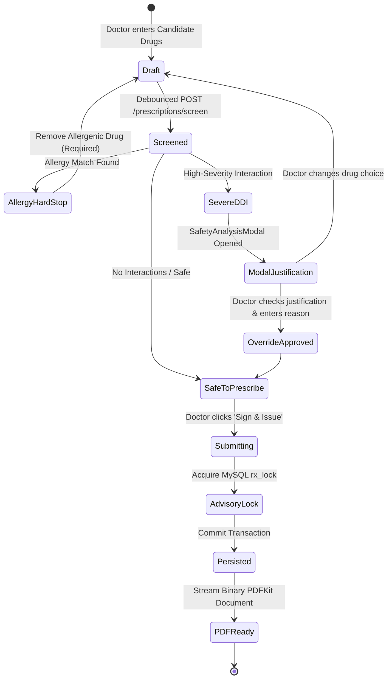
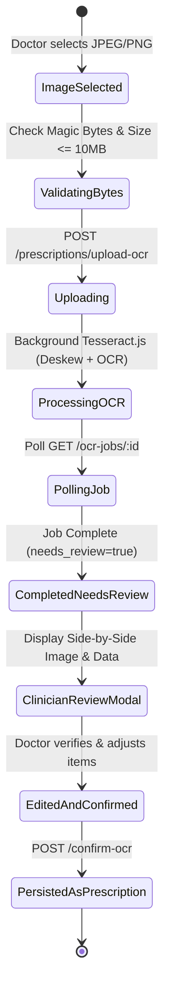
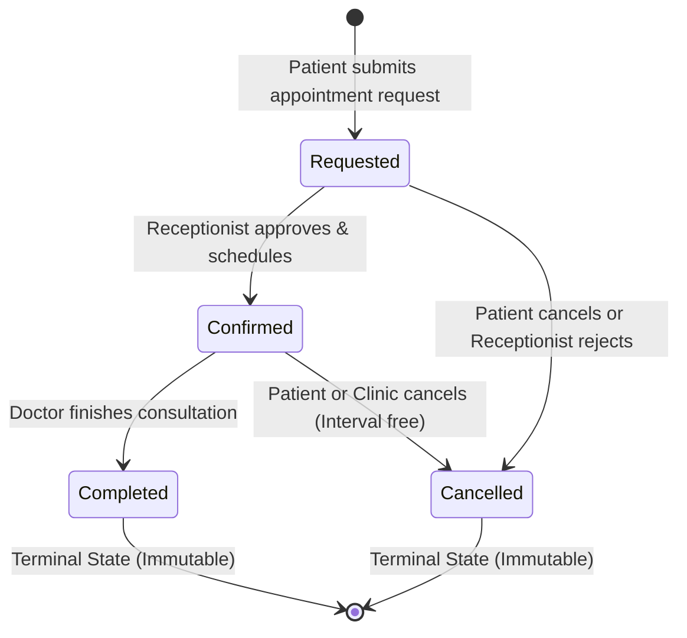

# 03_USER_STORIES_AND_WORKFLOWS.md — Healthcare CDSS User Stories & Workflows

> **Document Type**: Role-Based User Stories, Acceptance Criteria & Clinical Workflows  
> **Project**: Modular AI-Powered Multilingual Clinical Decision Support System (CDSS)  
> **Repository**: `dragyo7/healthcare-System-major-project-`  
> **Target Audience**: Product Managers, Frontend Engineers, QA Engineers, Clinical Testers  
> **Specification Version**: 1.0.0 (Authoritative Baseline)  
> **Cross-References**:
> - Core Frontend Requirements: [`docs/frontend-spec/01_PRIMARY_FRONTEND_REQUIREMENTS.md`](file:///E:/Major%20Project%20Code/docs/frontend-spec/01_PRIMARY_FRONTEND_REQUIREMENTS.md)
> - Detailed Component Specs: [`docs/frontend-spec/02_SECONDARY_COMPONENT_REQUIREMENTS.md`](file:///E:/Major%20Project%20Code/docs/frontend-spec/02_SECONDARY_COMPONENT_REQUIREMENTS.md)
> - Architecture & Backend Context: [`docs/frontend-spec/04_PROJECT_AND_BACKEND_CONTEXT.md`](file:///E:/Major%20Project%20Code/docs/frontend-spec/04_PROJECT_AND_BACKEND_CONTEXT.md)
> - Product Acceptance Contract: [`FINAL_GOAL.md`](file:///E:/Major%20Project%20Code/FINAL_GOAL.md)
> - Function-by-Function Flow Map: [`FLOW.md`](file:///E:/Major%20Project%20Code/FLOW.md)

---

## 1. User Personas & Clinical Roles

| Persona | Clinical Role | Primary Objectives | Key Safety / System Constraints |
| :--- | :--- | :--- | :--- |
| **Dr. Rahul Sharma** | Attending Cardiologist / General Physician | Review patient dossiers, draft safe prescriptions, evaluate complex drug interactions, author discharge care plans. | Cannot override documented patient allergies; cannot persist unverified OCR prescriptions; must provide written rationale for severe DDIs. |
| **Aarav Patil** | Discharged Inpatient (Cardiac) | Review authorized discharge instructions, understand medication timing, ask educational recovery questions. | Read-only access to own health record; cannot alter dosing; guided by fail-closed recovery assistant. |
| **Terrilyn Murphy** | Outpatient / Historical Synthea Record | View appointments, check active prescriptions, review general medical reference literature. | Has no saved hospital discharge summary; receives honest record absence disclosures; cannot access other patients' data. |
| **Sunita Verma** | Front-Desk Hospital Receptionist | Register walk-in patients, generate cryptographic activation links, manage appointment consultation queue. | **Zero clinical access**: Cannot view medical diagnoses, prescriptions, discharge plans, or run CDS tools. |

---

## 2. Role-Based User Stories & Acceptance Criteria

### Story Group 1: Onboarding, Authentication & Role Access

#### US-1.1: Unified Multi-Role Login with 1-Click Synthetic Demo Profiles
- **As a** hospital user (Doctor, Patient, or Receptionist),  
  **I want** to sign into the platform using a single entry point with clear role selection and demo shortcuts,  
  **so that** I can access my designated clinical or administrative workspace quickly and securely.
- **Acceptance Criteria**:
  1. Navigating to `/login` renders a 2-column CareUnity layout with 3 role tabs (`[♡ Patient]`, `[▦ Receptionist]`, `[✚ Doctor]`).
  2. Clicking a role tab updates the form title, email placeholder, and visual accent color (Doctor: Emerald/Indigo, Patient: Teal, Receptionist: Slate).
  3. Clicking a 1-click synthetic demo card (e.g. *"Doctor: Dr. Rahul Sharma"*) pre-fills verified credentials (`doctor@gmail.com` / `doctor123`).
  4. Submitting invalid credentials displays an explicit error banner: *"Invalid email or password"*; zero secrets or tokens are stored.
  5. Successful authentication stores role-scoped JWT in `localStorage` and redirects to the appropriate role dashboard (`/doctor`, `/patient`, or `/receptionist`).

#### US-1.2: Patient Self-Registration with Affirmative Ethical Consent Gate
- **As a** new patient seeking outpatient care,  
  **I want** to register for an online account with full transparency regarding data ethics and AI decision-support boundaries,  
  **so that** I can access my upcoming appointments and prescriptions securely.
- **Acceptance Criteria**:
  1. Accessing `/signup` renders the patient registration form (Full Name, Email, Password $\ge 8$ chars, Phone number).
  2. Includes an affirmative, unchecked consent box: `[ ] I have read and agree to the CDSS Ethics & Research Disclosures regarding non-autonomous decision support`.
  3. Attempting to submit without checking consent is blocked on the client side with an inline error tooltip.
  4. Submitting dispatches `POST /api/auth/patient/signup` with `consent_given: true`, `consent_version: "1.0"`, and UTC timestamp.
  5. Successfully creates patient record, signs a patient JWT, and redirects to `/patient`.

#### US-1.3: Cryptographic Single-Use Patient Account Activation
- **As a** walk-in patient registered at the hospital front desk,  
  **I want** to activate my online account using a secure, single-use activation link,  
  **so that** I can create my own private password without hospital staff knowing my credentials.
- **Acceptance Criteria**:
  1. Navigating to `/activate?token=<32_byte_token>` validates token existence.
  2. Renders an activation form with Password and Confirm Password inputs ($\ge 8$ characters).
  3. Submitting dispatches `POST /api/auth/patient/activate`.
  4. The server executes an atomic database transaction with `FOR UPDATE` row lock, hashes the password with bcrypt, and marks the token `used_at = NOW()`.
  5. Attempting to replay or re-use the same token immediately returns HTTP 400 Bad Request (`"Activation token has already been redeemed or expired"`).

#### US-1.4: Strict Server-Side Role Enforcement & BOLA Defense
- **As a** hospital compliance officer,  
  **I want** role boundaries enforced on every API route and parameter,  
  **so that** patients cannot inspect clinical dossiers and receptionists cannot view medical records.
- **Acceptance Criteria**:
  1. A patient attempting to navigate to `/doctor` or invoke `/api/doctor/patients` is redirected to `/unauthorized` and receives HTTP 403 Forbidden.
  2. A patient tampering with their request body to pass another patient's ID (e.g. `patient_id: 1` sent by Patient #149) is rejected with HTTP 403 Forbidden (`"Access denied: Patients are strictly prohibited from accessing another patient's health context"`).
  3. A receptionist account attempting to call `/api/doctor/cds` receives HTTP 403 Forbidden.

---

### Story Group 2: Doctor Clinical Workflows

#### US-2.1: Reviewing Patient Clinical Dossier & Documented Allergies
- **As an** attending physician,  
  **I want** to review an authorized patient's full medical history, active conditions, and documented allergies,  
  **so that** I have complete clinical context before prescribing or altering treatment.
- **Acceptance Criteria**:
  1. Selecting a patient in `/doctor/patients` loads their clinical dossier (`GET /api/doctor/patients/:id`).
  2. If the doctor has no authorized appointment relationship with that patient, the request returns HTTP 403 Forbidden with zero clinical data disclosed.
  3. Documented allergies (e.g. `Penicillin`) are prominently displayed in a persistent, bold red pill in the dossier header.
  4. Displays active conditions, recent vitals (blood pressure, pulse, SpO2), and past prescription history.

#### US-2.2: Prescription Drafting with Real-Time Sub-15ms DDI Screening
- **As an** attending physician,  
  **I want** to receive instant, sub-15ms feedback when drafting candidate medications,  
  **so that** I am immediately alerted to drug-drug interactions and patient contraindications.
- **Acceptance Criteria**:
  1. Entering candidate medications in `/doctor/prescriptions` triggers a debounced call to `POST /api/doctor/prescriptions/screen`.
  2. The screening engine evaluates 8 verified DrugBank rules, SIDER side-effect profiles, and documented allergies in under 15ms.
  3. Interacting drug combinations (e.g., `Aspirin` + `Warfarin` $\rightarrow$ Bleeding Risk `RUL-INT-002`) render an interactive warning card displaying clinical mechanism, severity level, and DailyMed monograph evidence.

#### US-2.3: Allergy Hard-Stop Interception (Cannot Override)
- **As an** attending physician,  
  **I want** the system to strictly prohibit prescribing medications to which the patient has a documented allergy,  
  **so that** life-threatening anaphylactic reactions are prevented.
- **Acceptance Criteria**:
  1. Adding a drug matching the patient's allergy (e.g. `Amoxicillin` for a penicillin-allergic patient) triggers an immediate **Red Hard-Stop Banner**:
     `🛑 ALLERGY CONTRAINDICATION: Proposed medication cross-reacts with documented allergy: PENICILLIN.`
  2. The server-side API returns HTTP 422 Unprocessable Entity with `{ cannot_override: true }`.
  3. The "Sign & Issue Prescription" button is completely disabled. Attempting to bypass via API tampering is blocked with HTTP 422 and 0 MySQL records written.

#### US-2.4: Severe DDI Clinician Justification & Audit Trail Override
- **As an** attending physician,  
  **I want** to clinically evaluate severe drug interactions and document my justification when treatment benefits outweigh risks,  
  **so that** emergency clinical discretion is preserved with an immutable audit trail.
- **Acceptance Criteria**:
  1. Drafting a severe DDI (e.g. `Atorvastatin` + `Clarithromycin`) triggers the `SafetyAnalysisModal`.
  2. The modal displays the interaction mechanism, adverse effects, and evidence-grounded alternatives.
  3. The doctor must check `[x] I have reviewed the interaction risk and clinically justify proceeding:` and enter a written rationale ($\ge 10$ characters).
  4. Submitting commits the prescription with `safety_override: true` and `safety_override_reason` persisted in the MySQL database audit log.

#### US-2.5: Generating, Viewing & Downloading Prescription PDF
- **As an** attending physician or verified patient,  
  **I want** to download an official, signed outpatient prescription slip in PDF format,  
  **so that** the patient can present it to a certified dispensing pharmacy.
- **Acceptance Criteria**:
  1. Clicking "Download PDF" calls `/api/doctor/prescriptions/:id/pdf` or `/api/patient/prescriptions/:id/pdf`.
  2. The Express server validates ownership, generates a PDFKit document in-memory with St. Mary Hospital header, prescriber credentials, medication table, and CDSS attestation stamp.
  3. Streams binary `%PDF-` bytes directly to the browser with correct `Content-Type: application/pdf`.
  4. An unauthorized user attempting to download another patient's prescription PDF receives HTTP 403 Forbidden with **zero bytes streamed**.

#### US-2.6: Prescription Image OCR Upload & Mandatory Clinician Confirmation
- **As an** attending physician,  
  **I want** to photograph or scan a physical paper prescription and have its text extracted automatically,  
  **so that** I can rapidly digitize patient medication history without manual typing.
- **Acceptance Criteria**:
  1. Uploading a prescription image in `/doctor/prescriptions` checks magic bytes and size ($\le 10\text{MB}$).
  2. Offline Tesseract.js executes auto-orientation deskewing and OCR text extraction.
  3. Extracted medications appear in a candidate review modal, marked with `needs_review: true`.
  4. **Clinician Confirmation Invariant**: Extracted OCR items **cannot be saved to the database** until the clinician explicitly reviews, edits, and clicks `"Approve & Sign OCR Prescription"`.

#### US-2.7: Authoring Structured Post-Discharge Care Directives
- **As an** attending physician,  
  **I want** to author structured discharge instructions, diet rules, warning triggers, and follow-up dates when releasing an inpatient,  
  **so that** the patient has clear, authorized guidance for home recovery.
- **Acceptance Criteria**:
  1. In `/doctor/discharge`, physician selects an authorized patient and enters:
     - Discharge diagnosis (e.g. *Acute Decompensated Heart Failure*).
     - Activity and wound dressing directives.
     - Dietary restrictions (e.g. *Low-sodium diet <2g/day*).
     - Red-flag warning symptoms requiring emergency hospital return.
     - Follow-up consultation date.
  2. Submitting commits to the `discharges` table via `POST /api/doctor/discharge`.

#### US-2.8: Querying Clinical CDS Assistant with Evidence Grounding
- **As an** attending physician,  
  **I want** to ask open-ended clinical questions regarding drug dosing, indications, and guidelines,  
  **so that** I receive rapid, citation-backed answers verified against DailyMed FDA monographs.
- **Acceptance Criteria**:
  1. In `/doctor/cds`, doctor submits a clinical inquiry with optional patient context.
  2. The request routes to FastAPI `/cds/evaluate`, querying the frozen FAISS index (2,204 chunks) via BM25 + Dense hybrid retrieval and Cross-Encoder reranking.
  3. Generated answers are checked by the `AnswerGroundingVerifier`.
  4. Grounded claims display clickable DailyMed monograph citation pills; unverified claims are safely withheld fail-closed (`withheld_verification_failure`).

---

### Story Group 3: Patient Self-Service & Recovery Workflows

#### US-3.1: Viewing Personal Health Dashboard & Emergency Directives (108/112)
- **As an** outpatient or discharged patient,  
  **I want** to see an immediate summary of my health records and emergency contact numbers,  
  **so that** I feel safe and informed regarding my ongoing care.
- **Acceptance Criteria**:
  1. Opening `/patient` displays active prescriptions, next appointment, and hospital emergency numbers (**108 / 112**).
  2. The page loads quickly with animated skeleton placeholders, showing zero layout shifts.

#### US-3.2: Reviewing Authorized Post-Discharge Care Instructions
- **As a** discharged patient,  
  **I want** to review my doctor's official post-discharge directives at any time,  
  **so that** I can follow my recovery regimen accurately at home.
- **Acceptance Criteria**:
  1. Opening `/patient/discharge` fetches the patient's latest discharge summary (`GET /api/patient/discharge`).
  2. Renders diagnosis, activity guidelines, dietary rules, emergency warning signs, and follow-up date.
  3. Includes a direct action button: `Ask Recovery Assistant 💬`.

#### US-3.3: Asking Post-Discharge Recovery Questions Grounded in Doctor's Plan
- **As a** discharged patient,  
  **I want** to ask questions like *"What care should I take?"* or *"When do I take my medication?"*,  
  **so that** I receive reassuring answers derived directly from my doctor's authorized instructions.
- **Acceptance Criteria**:
  1. In `/patient/assistant`, patient submits *"What care should I take?"*.
  2. The request evaluates against the patient's saved discharge record first (`pipeline_mode: "discharge_care_grounding"`).
  3. The response summarizes authorized discharge diagnosis, instructions, and warning triggers with an official EHR citation pill.
  4. Internal verifier diagnostic codes (`[INVALID_CITATION]`) never appear in the patient UI.

#### US-3.4: Asking General Medical Reference Questions via Frozen RAG
- **As a** patient,  
  **I want** to ask general questions about my medications (e.g. *"What is Metformin used for?"*),  
  **so that** I understand how my prescribed drugs work.
- **Acceptance Criteria**:
  1. Patient submits *"What is Metformin used for?"*.
  2. System detects this is a general reference query and routes to the frozen RAG hybrid pipeline.
  3. Answer is evaluated by the grounding verifier and returned with verified medical literature citations.

#### US-3.5: Honest Absence Response for Patients Without Discharge Plans
- **As a** patient who was never admitted as an inpatient (or has no saved discharge summary),  
  **I want** the system to tell me honestly that no discharge plan exists,  
  **so that** the AI does not invent or hallucinate fake hospital instructions.
- **Acceptance Criteria**:
  1. Patient Terrilyn Murphy (no discharge record) asks *"What care should I take?"*.
  2. System detects absent discharge record and returns an honest absence response with 0 citations (`abstained_policy`):
     *"No hospital discharge summary or post-discharge care directives are documented in your electronic health record. Please consult your treating care team for post-hospitalization instructions."*

#### US-3.6: Accessing Prescriptions & Downloading Signed PDF
- **As a** patient,  
  **I want** to view my active prescriptions and download the official PDF slip,  
  **so that** I can show it to my local pharmacy.
- **Acceptance Criteria**:
  1. In `/patient/prescriptions`, patient views list of signed prescriptions.
  2. Clicking "Download PDF" streams the official binary PDF directly to the patient's device.

#### US-3.7: Booking & Managing Doctor Appointments
- **As a** patient,  
  **I want** to schedule an outpatient consultation with an available hospital doctor,  
  **so that** I can receive timely medical attention.
- **Acceptance Criteria**:
  1. In `/patient/appointments`, patient selects doctor, date, available time slot, and reason for visit.
  2. Commits via `POST /api/patient/appointments` with status `requested`.
  3. Patient can view status changes (`requested` $\rightarrow$ `confirmed`) and cancel pending appointments.

#### US-3.8: Switching Platform Language (EN, HI, MR, GU)
- **As a** non-English speaking patient,  
  **I want** to view the platform in Hindi, Marathi, or Gujarati,  
  **so that** I can understand my medical instructions in my preferred language.
- **Acceptance Criteria**:
  1. Changing the header language selector to `hi`, `mr`, or `gu` updates UI labels instantly.
  2. Post-discharge AI answers are rendered in the selected regional language while preserving drug names and dosages (`Amlodipine 5mg`) untranslated.

---

### Story Group 4: Receptionist Administrative Operations

#### US-4.1: Front Desk Morning Check-in & Dashboard Overview
- **As a** front-desk receptionist,  
  **I want** to see today's appointment queue and doctor roster at a glance,  
  **so that** I can manage patient check-ins smoothly.
- **Acceptance Criteria**:
  1. Opening `/receptionist` displays today's scheduled consultations, pending check-ins, and active doctor count.

#### US-4.2: Walk-in Patient Registration & Intake
- **As a** front-desk receptionist,  
  **I want** to register new walk-in patients with demographic and emergency contact details,  
  **so that** they can be assigned to an attending physician.
- **Acceptance Criteria**:
  1. In `/receptionist/patients`, receptionist fills intake form (Name, Email, Phone, DOB, Gender, Address, Emergency Contact, Blood Group, Allergies).
  2. Enforces DOB range (`1900-01-01` to current date) and 10-digit phone number format.
  3. Submitting commits to the `patients` table via `POST /api/receptionist/patients`.

#### US-4.3: Generating Cryptographic Account Activation Link
- **As a** front-desk receptionist,  
  **I want** the system to automatically generate a single-use cryptographic activation link during patient intake,  
  **so that** I can provide it to the patient for setting their private password.
- **Acceptance Criteria**:
  1. Upon creating a patient, the system generates a 32-byte cryptographic token.
  2. Renders an activation card with link: `http://localhost:5173/activate?token=...` and a one-click "Copy Link" button.

#### US-4.4: Managing Doctor Consultation Schedules & Booking Appointments
- **As a** front-desk receptionist,  
  **I want** to book appointments for patients and update their consultation statuses,  
  **so that** clinic waiting times are minimized.
- **Acceptance Criteria**:
  1. In `/receptionist/appointments`, receptionist selects patient, doctor, date, and time slot.
  2. Submitting creates consultation with status `confirmed`.
  3. Receptionist can change status to `completed` or `cancelled`.

#### US-4.5: Preventing Overlapping Appointment Conflicts (409 Conflict)
- **As a** front-desk receptionist,  
  **I want** the system to reject overlapping appointment bookings for the same doctor at the same time,  
  **so that** double-booking conflicts are prevented.
- **Acceptance Criteria**:
  1. Attempting to book an appointment during a time slot already reserved for that doctor is rejected by the server with **HTTP 409 Conflict**.
  2. The UI renders an explicit alert: *"This doctor is already booked for the selected time slot. Please choose another time."*

---

## 3. Step-by-Step Clinical Workflow State Machines

### 3.1 Prescription Safety & Authorization State Machine

### 3.2 OCR Prescription Ingestion State Machine

### 3.3 Appointment Status Lifecycle State Machine

---

## 4. Verification & Traceability Matrix

| User Story ID | Boundary Covered | Primary Test File / Verification Runner |
| :--- | :--- | :--- |
| **US-1.1** | Multi-Role Login | `node scratch/test_activation_and_role_mismatch.js` |
| **US-1.2** | Patient Consent Gate | `node scratch/test_consent_regression_suite.js` |
| **US-1.3** | Single-Use Activation | `node scratch/test_activation_and_role_mismatch.js` |
| **US-1.4** | BOLA Defense | `node tests/integration/test_route_authorization_matrix.js` |
| **US-2.1** | Dossier Isolation | `node scratch/test_doctor_metrics_e2e.js` |
| **US-2.2** | Sub-15ms Screening | `python scripts/evaluate_ddi_comprehensive.py` |
| **US-2.3** | Allergy Hard Stop | `node scratch/test_adversarial_allergy_bypass.js` |
| **US-2.4** | DDI Override Audit | `node scratch/test_priority2_unified_prescription_gate.js` |
| **US-2.5** | PDF Binary Stream | `node scratch/gap_closure_master_verification.js` |
| **US-2.6** | OCR Clinician Review | `node tests/integration/test_prescription_ocr_live.js` |
| **US-2.7** | Discharge Authoring | `node scratch/test_patient_and_discharge.js` |
| **US-2.8** | Clinical RAG Grounding | `python -m pytest rag_module/tests/ -q` |
| **US-3.3** | Recovery Grounding | `python -m unittest scratch/test_priority1_honest_discharge.py` |
| **US-3.5** | Honest Absence | `node scratch/verify_e2e_10_scenarios.js` |
| **US-4.5** | 409 Slot Conflict | `node scratch/test_priority7_multilingual_and_appointments.js` |
