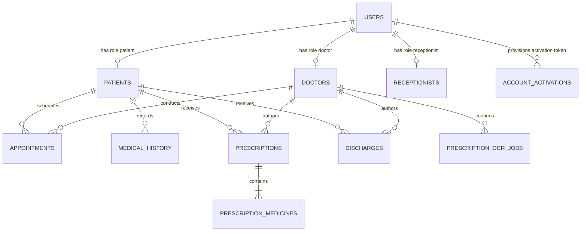
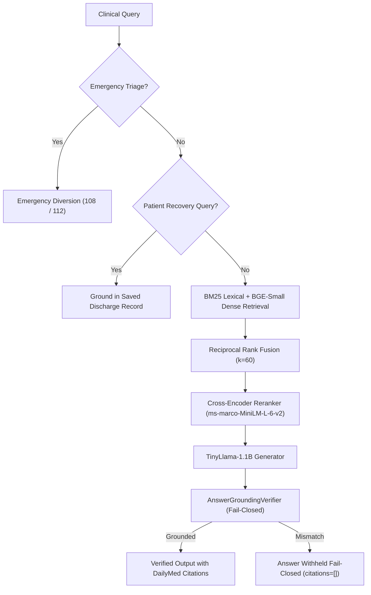

# 04_PROJECT_AND_BACKEND_CONTEXT.md — Project & Backend Context

> **Document Type**: Comprehensive Backend Architecture, API Contracts & System Integration Context  
> **Project**: Modular AI-Powered Multilingual Clinical Decision Support System (CDSS)  
> **Repository**: `dragyo7/healthcare-System-major-project-`  
> **Target Audience**: Full-Stack Engineers, AI Engineers, Frontend Architects  
> **Specification Version**: 1.0.0 (Authoritative Baseline)  
> **Cross-References**:
> - Core Frontend Requirements: [`docs/frontend-spec/01_PRIMARY_FRONTEND_REQUIREMENTS.md`](file:///E:/Major%20Project%20Code/docs/frontend-spec/01_PRIMARY_FRONTEND_REQUIREMENTS.md)
> - Detailed Component Specs: [`docs/frontend-spec/02_SECONDARY_COMPONENT_REQUIREMENTS.md`](file:///E:/Major%20Project%20Code/docs/frontend-spec/02_SECONDARY_COMPONENT_REQUIREMENTS.md)
> - User Stories & Workflows: [`docs/frontend-spec/03_USER_STORIES_AND_WORKFLOWS.md`](file:///E:/Major%20Project%20Code/docs/frontend-spec/03_USER_STORIES_AND_WORKFLOWS.md)
> - Authoritative Engineering Manual: [`AGENTS.md`](file:///E:/Major%20Project%20Code/AGENTS.md)
> - Product Acceptance Contract: [`FINAL_GOAL.md`](file:///E:/Major%20Project%20Code/FINAL_GOAL.md)
> - Living Status & Verification Snapshot: [`PROJECT_STATUS.md`](file:///E:/Major%20Project%20Code/PROJECT_STATUS.md)
> - Function-by-Function Flow Map: [`FLOW.md`](file:///E:/Major%20Project%20Code/FLOW.md)

---

## 1. Project Purpose, Mission & Academic Scope

### 1.1 The Clinical Challenge
Modern healthcare systems face severe clinician burnout, high patient volumes, and diagnostic fatigue. Unconstrained general-purpose Large Language Models (LLMs) cannot be deployed safely in hospitals because they hallucinate nonexistent drug dosages, fabricate clinical trials, and generate plausible-sounding but lethal recommendations.

### 1.2 The Architectural Solution
This project implements a **Modular Clinical Decision Support System (CDSS)** designed around four hardened safety invariants:
1. **Deterministic Drug Safety Over Generative Reasoning**: Drug interactions and documented allergy contraindications are screened via deterministic rule graphs in **< 15ms**, never by an unconstrained neural model.
2. **Strict Fail-Closed Medical RAG**: Generative intelligence is strictly grounded in 2,204 verified DailyMed FDA monographs and ICMR guidelines. Every generated statement is verified at the atomic proposition level by an `AnswerGroundingVerifier`. If grounding fails, the answer is safely withheld fail-closed (`withheld_verification_failure`).
3. **Physical Decoupling of EHR and Vector Storage**: Protected Health Information (PHI) resides exclusively in MySQL. Clinical knowledge resides in FAISS. Patient data is **never** vectorized, embedded, or leaked into the public corpus.
4. **Non-Autonomous Assistive Invariant**: The system never prescribes autonomously; every clinical order requires explicit human clinician review and cryptographic attestation.

---

## 2. Technology Stack & Physical Service Topology

```mermaid
graph TD
    UserBrowser["Browser Client (Desktop / Mobile)"] -->|Port 5173| UnifiedFrontend["Unified React 19 + Vite 8 SPA"]
    UnifiedFrontend -->|HTTP / JWT Bearer| ExpressGateway["Express EHR Gateway (Port 5000 / 5001)"]
    ExpressGateway -->|SQL Pool (Port 3306)| MySQL["MySQL 8.0 Database (rag_healthcare)"]
    ExpressGateway -->|Zero-PII HTTP POST| FastAPIGateway["FastAPI CDS Gateway (Port 8000)"]
    FastAPIGateway --> DrugSafety["Deterministic Drug Safety Engine (<15ms)"]
    FastAPIGateway --> Multilingual["Indic Multilingual Module (en, hi, mr, gu)"]
    FastAPIGateway --> FrozenRAG["Frozen Medical RAG v2.10 (FAISS + TinyLlama)"]
```

### 2.1 Technology Stack Details
- **Frontend Layer**:
  - React 19.0.0, Vite 8.0, Tailwind CSS 3.4.
  - React Router DOM 7.0 for declarative route management and persistent deep-linking.
  - Lucide React for accessible medical and administrative iconography.
  - PDFKit binary streaming handler via client-side Blob conversion.
- **EHR & Security Gateway Layer**:
  - Node.js 18+ with Express 4.18.
  - JWT (`jsonwebtoken`) for role-scoped bearer authorization.
  - Bcrypt for cryptographic password hashing ($\ge 10$ salt rounds).
  - MySQL2 connection pooling with session advisory locks (`GET_LOCK`).
  - Tesseract.js (strictly offline with local `.traineddata` and `.wasm` assets).
  - Multer with magic-byte image validation.
- **Clinical AI & Intelligence Layer**:
  - Python 3.10+ with FastAPI 0.100+.
  - PyTorch & HuggingFace Transformers (running fully offline with `HF_HUB_OFFLINE=1`).
  - FAISS (Facebook AI Similarity Search) C++ bindings.
  - Dense Retriever: `BAAI/bge-small-en` (384 dimensions).
  - Sparse Retriever: BM25 lexical ranker with Reciprocal Rank Fusion ($k=60$).
  - Reranker: Cross-Encoder `cross-encoder/ms-marco-MiniLM-L-6-v2`.
  - Generator: `TinyLlama-1.1B-Chat-v1.0` (compact local CPU/GPU generator).

### 2.2 Physical Port Allocations

| Service Name | Port | Protocol | Binding Address | Description |
| :--- | :---: | :---: | :---: | :--- |
| **Unified Frontend** | `5173` | HTTP | `http://localhost:5173` | Single-port entry point hosting Doctor, Patient, Receptionist, and Activation portals. |
| **Express EHR Gateway** | `5000` | HTTP | `http://127.0.0.1:5000` | Primary production EHR backend connected to `rag_healthcare`. |
| **Express Test Backend** | `5001` | HTTP | `http://127.0.0.1:5001` | Test/Demonstration EHR backend connected to `rag_healthcare_test`. |
| **FastAPI CDS Gateway** | `8000` | HTTP | `http://127.0.0.1:8000` | Clinical orchestration, drug screening, and frozen RAG inference. |
| **MySQL Database Server** | `3306` | TCP/SQL | `127.0.0.1:3306` | Relational EHR database (MySQL 8.0.39). |

---

## 3. Database Schema & Relational Architecture

The relational schema consists of 15 normalized tables structured through forward database migrations (`migrations/000` through `migrations/009`):



### 3.1 Key Relational Tables Inventory

1. `users`:
   - `user_id` (PK, AUTO_INCREMENT), `email` (UNIQUE), `password` (bcrypt hash), `full_name`, `phone`, `role` (`'doctor'`, `'patient'`, `'receptionist'`), `staff_status` (`'pending'`, `'approved'`, `'rejected'`), `consent_given` (BOOLEAN), `consent_timestamp` (DATETIME), `consent_version` (VARCHAR), `created_at`.
2. `doctors`:
   - `doctor_id` (PK), `user_id` (FK to users), `specialization`, `license_number` (UNIQUE), `experience_years`, `consultation_fee`, `availability_status`.
3. `patients`:
   - `patient_id` (PK), `user_id` (FK to users), `date_of_birth` (DATE), `gender` (`'Male'`, `'Female'`, `'Other'`), `blood_group`, `address`, `emergency_contact`, `allergies` (TEXT).
4. `receptionists`:
   - `receptionist_id` (PK), `user_id` (FK to users), `shift_timings`, `desk_number`.
5. `appointments`:
   - `appointment_id` (PK), `patient_id` (FK), `doctor_id` (FK), `appointment_date` (DATE), `appointment_time` (TIME), `status` (`'requested'`, `'confirmed'`, `'completed'`, `'cancelled'`), `reason` (TEXT), `created_at`.
6. `prescriptions`:
   - `prescription_id` (PK), `patient_id` (FK), `doctor_id` (FK), `prescription_date` (DATE), `diagnosis` (TEXT), `notes` (TEXT), `safety_override` (BOOLEAN), `safety_override_reason` (TEXT).
7. `prescription_medicines`:
   - `medicine_id` (PK), `prescription_id` (FK), `medicine_name`, `dosage`, `frequency`, `duration`, `instructions`.
8. `discharges`:
   - `discharge_id` (PK), `patient_id` (FK), `doctor_id` (FK), `discharge_date` (DATE), `discharge_diagnosis` (TEXT), `discharge_instructions` (TEXT), `dietary_instructions` (TEXT), `warning_signs` (TEXT), `follow_up_date` (DATE).
9. `prescription_ocr_jobs`:
   - `job_id` (PK), `file_path`, `ocr_status` (`'pending'`, `'processing'`, `'completed'`, `'failed'`), `extracted_text` (LONGTEXT), `structured_data` (JSON), `confirmed_by_doctor_id` (FK to doctors).
10. `account_activations`:
    - `activation_id` (PK), `user_id` (FK), `token_hash` (VARCHAR 64, SHA-256), `expires_at` (DATETIME), `used_at` (DATETIME, NULL until redeemed).
11. `prescription_idempotency_keys`:
    - `idempotency_key` (PK, UUID), `prescription_id` (FK), `doctor_id` (FK), `patient_id` (FK), `created_at`.

---

## 4. Complete API Route Surface & Contracts

### 4.1 Authentication & Onboarding Routes (Express Gateway)

| Endpoint | Method | Role Required | Request Payload Summary | Key Response Fields / Status Codes |
| :--- | :---: | :---: | :--- | :--- |
| `/api/auth/doctor/login` | `POST` | Public | `{ email, password }` | `200 OK` $\rightarrow$ `{ token, doctor: { doctor_id, name, specialization } }`<br>`401` $\rightarrow$ Invalid credentials |
| `/api/auth/patient/login` | `POST` | Public | `{ email, password }` | `200 OK` $\rightarrow$ `{ token, patient: { patient_id, name } }`<br>`401` $\rightarrow$ Invalid credentials |
| `/api/auth/receptionist/login` | `POST` | Public | `{ email, password }` | `200 OK` $\rightarrow$ `{ token, receptionist: { receptionist_id, name } }`<br>`401` $\rightarrow$ Invalid credentials |
| `/api/auth/patient/signup` | `POST` | Public | `{ full_name, email, password, phone, consent_given, consent_version }` | `201 Created` $\rightarrow$ `{ token, patient_id }`<br>`400` $\rightarrow$ Missing consent or duplicate email |
| `/api/auth/patient/activate` | `POST` | Public | `{ token, password }` | `200 OK` $\rightarrow$ `{ message: "Account successfully activated" }`<br>`400` $\rightarrow$ Replay or expired token |

---

### 4.2 Doctor Clinical Workspace Routes (Express Gateway)

| Endpoint | Method | Role Required | Request Payload Summary | Key Response Fields / Status Codes |
| :--- | :---: | :---: | :--- | :--- |
| `/api/doctor/dashboard` | `GET` | Doctor | *None* (Bearer token) | `200 OK` $\rightarrow$ `{ stats: { active_patients, today_appointments, active_prescriptions } }` |
| `/api/doctor/patients` | `GET` | Doctor | Query: `?search=<term>` | `200 OK` $\rightarrow$ `{ patients: [...] }` |
| `/api/doctor/patients/:patientId` | `GET` | Doctor | *None* (URL param) | `200 OK` $\rightarrow$ `{ patient, medical_history, active_prescriptions }`<br>`403` $\rightarrow$ Doctor not authorized for patient |
| `/api/doctor/prescriptions/screen` | `POST` | Doctor | `{ patient_id, candidate_medications }` | `200 OK` $\rightarrow$ `{ screen_status, contraindications, interactions }` |
| `/api/doctor/prescriptions` | `POST` | Doctor | `{ patient_id, diagnosis, medicines: [...], safety_override, safety_override_reason }` | `201 Created` $\rightarrow$ `{ prescription_id }`<br>`422` $\rightarrow$ Allergy hard stop (`cannot_override: true`) |
| `/api/doctor/prescriptions/:id/pdf` | `GET` | Doctor | *None* (URL param) | `200 OK` $\rightarrow$ Binary Stream (`Content-Type: application/pdf`)<br>`403` $\rightarrow$ Unauthorized |
| `/api/doctor/prescriptions/upload-ocr`| `POST` | Doctor | Multipart FormData (`image` file $\le 10\text{MB}$) | `202 Accepted` $\rightarrow$ `{ job_id, status: "pending" }` |
| `/api/doctor/prescriptions/ocr-jobs/:id`| `GET` | Doctor | *None* (URL param) | `200 OK` $\rightarrow$ `{ job_id, status, extracted_text, structured_data }` |
| `/api/doctor/prescriptions/confirm-ocr`| `POST` | Doctor | `{ job_id, patient_id, diagnosis, medicines: [...] }` | `201 Created` $\rightarrow$ `{ prescription_id }` |
| `/api/doctor/discharge` | `POST` | Doctor | `{ patient_id, discharge_diagnosis, discharge_instructions, dietary_instructions, warning_signs, follow_up_date }` | `201 Created` $\rightarrow$ `{ discharge_id }` |
| `/api/doctor/cds` | `POST` | Doctor | `{ patient_id, clinical_query, candidate_medications, language }` | `200 OK` $\rightarrow$ CDSEvaluateResponse (from FastAPI) |

---

### 4.3 Patient Self-Service Routes (Express Gateway)

| Endpoint | Method | Role Required | Request Payload Summary | Key Response Fields / Status Codes |
| :--- | :---: | :---: | :--- | :--- |
| `/api/patient/dashboard` | `GET` | Patient | *None* (Bearer token) | `200 OK` $\rightarrow$ `{ appointments, prescriptions, discharge_summary }` |
| `/api/patient/prescriptions` | `GET` | Patient | *None* (Bearer token) | `200 OK` $\rightarrow$ `{ prescriptions: [...] }` |
| `/api/patient/prescriptions/:id/pdf`| `GET` | Patient | *None* (URL param) | `200 OK` $\rightarrow$ Binary Stream (`Content-Type: application/pdf`)<br>`403` $\rightarrow$ BOLA Forbidden |
| `/api/patient/discharge` | `GET` | Patient | *None* (Bearer token) | `200 OK` $\rightarrow$ `{ discharge: { discharge_diagnosis, discharge_instructions, ... } }` |
| `/api/patient/cds` | `POST` | Patient | `{ clinical_query, language }` (Caller ID resolved from JWT) | `200 OK` $\rightarrow$ CDSEvaluateResponse (grounded in discharge record) |
| `/api/patient/appointments` | `POST` | Patient | `{ doctor_id, appointment_date, appointment_time, reason }` | `201 Created` $\rightarrow$ `{ appointment_id, status: "requested" }` |
| `/api/patient/appointments/:id/cancel`| `PATCH`| Patient | `{ reason }` | `200 OK` $\rightarrow$ `{ status: "cancelled" }` |

---

### 4.4 Receptionist Administrative Routes (Express Gateway)

| Endpoint | Method | Role Required | Request Payload Summary | Key Response Fields / Status Codes |
| :--- | :---: | :---: | :--- | :--- |
| `/api/receptionist/patients` | `POST` | Receptionist | `{ full_name, email, phone, date_of_birth, gender, blood_group, emergency_contact, address, allergies }` | `201 Created` $\rightarrow$ `{ patient_id, activation_token, activation_url }` |
| `/api/receptionist/appointments` | `POST` | Receptionist | `{ patient_id, doctor_id, appointment_date, appointment_time, reason }` | `201 Created` $\rightarrow$ `{ appointment_id, status: "confirmed" }`<br>`409 Conflict` $\rightarrow$ Slot booked |
| `/api/receptionist/appointments/:id/status`| `PATCH`| Receptionist | `{ status: "confirmed" \| "completed" \| "cancelled" }` | `200 OK` $\rightarrow$ `{ appointment_id, status }` |
| `/api/receptionist/doctors` | `GET` | Receptionist | *None* (Bearer token) | `200 OK` $\rightarrow$ `{ doctors: [...] }` |

---

### 4.5 Centralized Clinical Orchestration (FastAPI Gateway)

| Endpoint | Method | Payload Contract | Response Schema | Description |
| :--- | :---: | :--- | :--- | :--- |
| `/cds/evaluate` | `POST` | `{ clinical_query, candidate_medications, patient_context, language }` | `CDSEvaluateResponse`<br>`{ answer, citations: [...], is_grounded, verification_status, pipeline_mode, abstained }` | Evaluates clinical inquiry, discharge care grounding, or general medical RAG. |
| `/cds/screen-prescription`| `POST` | `{ candidate_medications, active_medications, allergies, active_conditions }` | `PrescriptionScreenResponse`<br>`{ screen_status: "safe"\|"warning"\|"critical", contraindications: [...], interactions: [...] }` | Evaluates 8 DrugBank interaction rules, SIDER profiles, and patient allergies in < 15ms. |
| `/health` | `GET` | *None* | `{ status: "healthy", indexed_chunks: 2204 }` | Liveness and index vector readiness probe. |

---

## 5. Security & Authentication Boundaries

### 5.1 Role-Based Access Control (RBAC)
- All requests entering the Express EHR Gateway must include an HTTP header: `Authorization: Bearer <JWT>`.
- Express parses the token, extracts `{ user_id, email, role }`, and verifies that `users.staff_status` is `'approved'` (for clinical and administrative staff).
- Role guards (`authenticateDoctor`, `authenticatePatient`, `authenticateReceptionist`) strictly reject calls from mismatched roles with HTTP 403 Forbidden.

### 5.2 Broken Object Level Authorization (BOLA) Defense
- A client can never query by supplying an arbitrary patient ID in the payload.
- In all patient routes (`/api/patient/*`), Express looks up the `patient_id` linked to the authenticated `req.user.user_id`.
- If an attacker intercepts the request and injects `{ patient_id: 2 }`, Express verifies:
  ```javascript
  if (req.body.patient_id && Number(req.body.patient_id) !== Number(patient.patient_id)) {
    return res.status(403).json({
      message: "Access denied: Patients are strictly prohibited from accessing another patient's health context"
    });
  }
  ```

### 5.3 Zero-PII Context Sanitization
- Before forwarding clinical context from Express to FastAPI (`/cds/evaluate`), the backend runs `sanitizePatientContext(rawData)`:
  - Strips patient names, telephone numbers, Aadhaar/SSN identifiers, and street addresses.
  - Passes only de-identified clinical tokens (e.g. *Age: 54, Gender: Male, Allergies: Penicillin, Conditions: Heart Failure*).
  - Guarantees zero PII persists in vector caches or model activations.

---

## 6. Frozen RAG Baseline & AI Engine Invariants

The RAG intelligence backend is **HARD FROZEN at commit `497a547` (v2.10)**.



### 6.1 Unchangeable AI Parameters
- Production Index: 2,204 chunks in [data/faiss_index/index_v2.bin](file:///E:/Major%20Project%20Code/data/faiss_index/index_v2.bin).
- Dense Retriever: `BAAI/bge-small-en` (384 dimensions).
- Sparse Retriever: BM25 lexical search.
- Reranker: `cross-encoder/ms-marco-MiniLM-L-6-v2`.
- Local Generator: `TinyLlama-1.1B-Chat-v1.0`.
- Grounding Verifier: `AnswerGroundingVerifier` enforcing atomic proposition verification against retrieved evidence chunks.

---

## 7. Synthetic Data Provenance & Real Boundaries

### 7.1 Synthea Cohort Invariant (DEC-043)
- The test cohort contains 5 synthetic patients imported from Synthea FHIR R4 archives (e.g., Terrilyn Murphy #149, Trinh Sanford #150, Brain Wuckert #151, Jospeh Gerhold #152, Chauncey Jones #153).
- **Historical Provenance Rule**: Historical FHIR `MedicationRequest` entries represent past synthetic claims, **not current clinician-ordered active prescriptions**.
- Missing dosage or timing fields in synthetic files are stored as explicit SQL `NULL` values. The system **never fabricates placeholder doses** (e.g., *1990-01-01*, *O+*, *None*).
- A synthetic patient who has never been discharged from a hospital inpatient stay (such as Terrilyn Murphy) has 0 discharge records in MySQL, correctly triggering honest absence disclosures (`abstained_policy`).

---

## 8. Current Implementation Status & Integration Reality

| Subsystem | Verified Reality | Implementation Notes |
| :--- | :---: | :--- |
| **Unified Frontend (5173)** | **100% Operational** | Builds cleanly in 783ms (`0 errors across 2,253 modules`). Runs on `http://localhost:5173`. |
| **Express EHR Backend (5000/5001)** | **100% Operational** | Fully supports RBAC, BOLA, PDF streaming, offline Tesseract OCR, and advisory locking. |
| **FastAPI CDS Gateway (8000)** | **100% Operational** | Evaluates `/cds/evaluate` and `/cds/screen-prescription` in < 15ms for deterministic safety. |
| **MySQL Database (3306)** | **100% Operational** | Migrated through migration `009`. Verified on `rag_healthcare_test`. |
| **Known Operating Limit** | **Compact Generator Anaphora Drift** | TinyLlama-1.1B occasionally produces preamble variations. The `AnswerGroundingVerifier` safely catches and withholds these fail-closed. |
